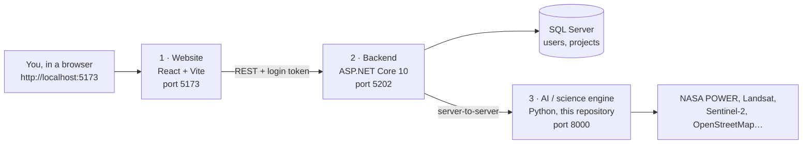

# Run the full URBANOVA project locally

> **Just want to try it?** No install needed:
> - **Full app:** https://urbanova-arch.vercel.app/
> - **Trend Detective only:** https://56-228-129-51.sslip.io/#/detective
>
> This guide is for running your own copy.

URBANOVA has three parts. They run on your computer as three programs, each in its own terminal:



| Part | Repository | What it does | Local address |
|---|---|---|---|
| **AI engine** | this repository ([9amole/Urbanova-nasa](https://github.com/9amole/Urbanova-nasa)) | Analyses (climate, surface heat, vegetation, shade, heat stress…), the Trend Detective, reports, the help assistant | http://127.0.0.1:8000 |
| **Backend** | [zeyadlotfy/urbanova](https://github.com/zeyadlotfy/urbanova), folder `backend/` | Accounts, companies, projects in SQL Server; forwards the science to the AI engine | http://localhost:5202 |
| **Website** | [zeyadlotfy/urbanova](https://github.com/zeyadlotfy/urbanova), folder `frontend/` | The app people use | http://localhost:5173 |

The website only talks to the backend. The backend talks to the AI engine: it creates an engine account for each user
by itself (from a secret "bridge key"), so nobody logs in to the engine by hand.

> **Shortcut:** to skip part 3, leave the backend pointing at the deployed engine
> (`https://56-228-129-51.sslip.io`, the default) and do only steps 2 and 3 below.

---

## 0 · Install these first (once)

| Tool | Version | Download |
|---|---|---|
| Git | any | https://git-scm.com/downloads |
| Python | **3.11** | https://www.python.org/downloads/ (tick "Add python.exe to PATH") |
| .NET SDK | **10.0.402 or newer** (the backend's `global.json` requires it) | https://dotnet.microsoft.com/download/dotnet/10.0 |
| EF Core tool | for the database | `dotnet tool install --global dotnet-ef` |
| Node.js | **22 LTS** or newer (Vite 8 needs 20.19+ or 22.12+) | https://nodejs.org/ |
| SQL Server | any edition on your PC: **LocalDB**, **Express** or **Developer** | https://www.microsoft.com/sql-server/sql-server-downloads |

Check them in a terminal:

```powershell
git --version; python --version; dotnet --list-sdks; dotnet ef --version; node --version
```

`dotnet --list-sdks` must show a `10.0.4xx` (or newer) line.

## 1 · Get the code

Put both repositories side by side, for example in `Downloads`:

```powershell
git clone https://github.com/9amole/Urbanova-nasa.git
```

```powershell
git clone https://github.com/zeyadlotfy/urbanova.git
```

---

## 2 · Start the AI engine (terminal 1)

```powershell
cd Urbanova-nasa
```

```powershell
.\run.ps1 setup
```

```powershell
.\run.ps1
```

The first setup installs the Python packages (about 3–5 minutes). Leave this terminal open.

**Check:** open http://127.0.0.1:8000/#/detective. The Trend Detective page loads. It needs no account.

<details><summary>macOS / Linux</summary>

```bash
python3.11 -m venv .venv && .venv/bin/pip install -r requirements.txt && .venv/bin/python -m urbanova.main
```
</details>

Optional: the engine's AI help assistant uses a free model when you give it your own key. In the same terminal, **before**
`.\run.ps1`, run `$env:URBANOVA_LLM_PROVIDERS = "groq"` and `$env:URBANOVA_LLM_GROQ_API_KEY = "<your key>"`. Everything else
works without a key. Never commit a key.

---

## 3 · Start the backend (terminal 2)

```powershell
cd urbanova\backend
```

### 3a · Your private settings file

Copy the example:

```powershell
copy src\Urbanova.Api\appsettings.Local.example.json src\Urbanova.Api\appsettings.Local.json
```

Make three secrets (run this three times and use a different output each time):

```powershell
python -c "import secrets; print(secrets.token_hex(32))"
```

Open `src\Urbanova.Api\appsettings.Local.json` and fill it in like this:

```json
{
  "ConnectionStrings": {
    "UrbanovaDb": "Server=(localdb)\\MSSQLLocalDB;Database=Urbanova_Dev;Trusted_Connection=True;TrustServerCertificate=True"
  },
  "Jwt": { "Key": "<secret 1>" },
  "EmailVerification": { "OtpHashKey": "<secret 2>" },
  "Email": { "Provider": "FileDrop" },
  "AiEngine": {
    "BaseUrl": "http://127.0.0.1:8000",
    "BridgeKey": "<secret 3>"
  }
}
```

- **`Server=`** depends on the SQL Server you installed:
  - LocalDB: `(localdb)\\MSSQLLocalDB`
  - Express: `.\\SQLEXPRESS`
  - Developer/Standard default instance: `localhost`
- **`AiEngine.BaseUrl`**: `http://127.0.0.1:8000` uses your local engine from step 2. Use
  `https://56-228-129-51.sslip.io` for the deployed one.
- **Keep `BridgeKey` the same from now on.** It decides which engine account each user gets; if you change it, users
  lose access to their earlier analyses.
- This file is ignored by Git. Never commit it.

### 3b · Create the database (once, and after each `git pull` that adds migrations)

```powershell
sqllocaldb start MSSQLLocalDB
```

(Only for LocalDB.) Then run the migration, passing the **same connection string** as in your settings file:

```powershell
dotnet ef database update --project src/Urbanova.Infrastructure --startup-project src/Urbanova.Api --connection "Server=(localdb)\MSSQLLocalDB;Database=Urbanova_Dev;Trusted_Connection=True;TrustServerCertificate=True"
```

It ends with `Done.`. Pass `--connection` every time: the migration tool does **not** read `appsettings.Local.json`. Without
it, the tool tries `.\SQLEXPRESS` and fails with "error: 26 - Error Locating Server/Instance".

### 3c · Run it

```powershell
dotnet run --project src/Urbanova.Api --launch-profile http
```

**Check:**
- http://localhost:5202/health/ready shows `Healthy`.
- http://localhost:5202/swagger lists the API.

Leave this terminal open.

---

## 4 · Start the website (terminal 3)

```powershell
cd urbanova\frontend
```

Create the file `frontend\.env.development` with this one line:

```
VITE_API_URL=http://localhost:5202
```

Then install and run:

```powershell
npm ci
```

```powershell
npm run dev
```

**Open http://localhost:5173.** The website never needs the AI engine's address; it reaches the science through the backend.

---

## 5 · First use: the whole flow

1. **Create an account** on the website: click **Create account** and finish the sign-up steps.
2. **Verify your email.** Locally, no email is sent. The backend writes each message as a `.txt` file in
   `urbanova\backend\src\Urbanova.Api\AppData\mail\`. Open the newest file, copy the **6-digit code**, and enter it on
   the website.
3. **Log in**, open the **dashboard**, and click **Create a project**.
4. **Site setup:**
   - Give the project a name, a type and **latitude / longitude**.
   - Add the site boundary: draw it, or paste or import a GeoJSON file.
   - Click **Save & connect site**, then **Save & confirm location**. The backend now creates the matching project in
     the AI engine.
5. Continue through the project steps:
   - **Inputs** (design files);
   - **Planning rules**;
   - **Readiness**;
   - **Scenarios**;
   - **Run analysis**;
   - **Results**;
   - **🔎 Trend Detective**;
   - **Compare**;
   - **Report**;
   - **Dashboard**.

**Test data with known results** (all files in `Urbanova-nasa\samples\`):

| Test | Latitude, longitude | Boundary file | Expected |
|---|---|---|---|
| New Cairo plot (trends) | 30.0200, 31.5000 | `spaceapps_new_cairo_plot.geojson` | About 3.9 °C cooler than the surrounding desert after ~2005 |
| Novo Progresso, Brazil (trends) | −7.0300, −55.4000 | `spaceapps_novo_progresso_plot.geojson` | Surface temperature +3.47 °C per decade, greenness declining |
| Full design flow | 30.1200, 31.8500 | `sample_site_boundary.geojson` | Then upload `sample_plan_baseline.geojson`, `sample_planning_conditions.pdf` and `sample_rates_TEST_ONLY.csv`, add `sample_alternative_additions.geojson` to an alternative, and tick "synthetic or test data" |

Step-by-step checks and every expected value are in [docs/TESTING_TRENDS.md](docs/TESTING_TRENDS.md).

---

## Stopping and starting again

- **To stop:** press **Ctrl+C** in each of the three terminals.
- **Next time:** run step 2's `.\run.ps1`, step 3c's `dotnet run …` and step 4's `npm run dev`, in that order.
- **What's kept:** your data. Users and projects are in SQL Server; analyses are in `Urbanova-nasa\data\`.

## Option: run the backend and website with Docker

The `urbanova` repository also has a `docker-compose.yml` (SQL Server + backend + website on http://localhost:3000).

1. Install [Docker Desktop](https://www.docker.com/products/docker-desktop/).
2. In `urbanova\`, copy `.env.example` to `.env` and fill in `SQL_SERVER_PASSWORD`, `JWT_KEY`, `EMAIL_OTP_HASH_KEY` and
   `URBANOVA_BRIDGE_KEY`.
3. Pick the AI engine:
   - Keep `AI_ENGINE_URL` as the deployed engine; or
   - for your local engine, set `AI_ENGINE_URL=http://host.docker.internal:8000`, and start the engine with
     `$env:URBANOVA_HOST = "0.0.0.0"` before `.\run.ps1` so the container can reach it.
4. Run these commands:
   ```powershell
   docker compose up -d sqlserver
   ```
   ```powershell
   docker compose run --rm migrator
   ```
   ```powershell
   docker compose up -d
   ```

We checked the steps above without Docker. We haven't tested the Docker route ourselves.

## If something goes wrong

| Problem | Fix |
|---|---|
| `A compatible .NET SDK was not found` / mentions `10.0.402` | Install the newest .NET 10 SDK (step 0). |
| `error: 26 - Error Locating Server/Instance` on `dotnet ef` | Add `--connection "<your connection string>"` (step 3b); for LocalDB run `sqllocaldb start MSSQLLocalDB` first. |
| Backend log: `Configure AiEngine:BridgeKey with a stable secret of at least 32 bytes` | Add `BridgeKey` (64 hex characters from step 3a) to `appsettings.Local.json`. |
| "The scientific service could not provision…" / Save & connect fails | The AI engine isn't running or `AiEngine.BaseUrl` is wrong. Check http://127.0.0.1:8000 in a browser. |
| Website shows network errors | Is the backend running on 5202? Is `VITE_API_URL` right? Restart `npm run dev` after editing `.env.development`. |
| No verification code arrives | Locally there is no email: read the newest `.txt` in `backend\src\Urbanova.Api\AppData\mail\` (step 5). |
| A port is already in use | Close the old terminal, or change the port: engine `$env:URBANOVA_PORT = "8001"` (and update `AiEngine.BaseUrl`); website `npm run dev -- --port 5174`. |
| `npm ci` or `dotnet restore` fails with `ECONNRESET` | Your network is blocking the package servers. Try again, or use another network or a phone hotspot. |
| Trend runs say "the archive was probably busy" | Landsat is read live from the Microsoft Planetary Computer. Run it again; scenes already read are kept. |

## How this guide was checked

We followed these steps on Windows 11 on 14 November 2026 and checked each result:

| Step | Result |
|---|---|
| AI engine | Starts and serves the Trend Detective |
| Backend database | Builds and migrates on LocalDB |
| Backend | Starts and reports `Healthy` |
| Backend → engine | Registers a user, creates a project and connects it to the local AI engine (`scientificProjectId` returned) |
| Public Trend Detective | Reachable through the backend |
| Website (`npm ci` / `npm run dev`) | **Not tested on that run**: the network blocked the npm package registry. It is a standard Vite app; follow step 4. |
