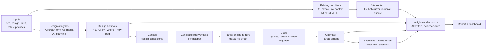

# URBANOVA Phase 1 — smart upgrade specification: from metrics to engineering decisions, with AI

**Status:** revision 2, 2026-11-07. Revision 1 was approved by the project decision maker (data science lead) on 2026-11-04. Revision 2 applies the step 2 review (independent critique, research and the idea-fit review, [IDEA_FIT_REVIEW.md](IDEA_FIT_REVIEW.md)), which the decision maker approved on 2026-11-07. Supervisor comments go into the open decisions in §13. **Implementation has not started**; it begins with stage S1 when the team gives the go-ahead.

**Scope:** this is **still Phase 1**. It does not add a new phase. It upgrades the existing Phase 1 system, whose findings, explanations and recommendations are rule-based today (fixed thresholds and fixed text templates), into one that uses AI, ML and data-driven methods. The Phase 1 Functional Requirements stay the scope. (The file name says PHASE2 only for historical reasons.)

It answers the supervisors' points one by one:
§2 Analysis Mapping, §3 Scientific Validation, §4 Hotspot Detection, §5 Engineering Insights, §6 Recommendations Logic, §7 Scenario Comparison, §8 Reports, §1 System Integration, and §10 Code Changes & Acceptance Criteria.

**What is rule-based today, and what replaces it:**

| Today (Phase 1 as built) | After this upgrade (still Phase 1) |
|---|---|
| A finding fires when one metric crosses a fixed band | Design hotspots are located on the drawing with exact geometry, with area, severity, metrics and causes (§4) |
| Recommendations are fixed templates attached to a finding | Candidate interventions are generated, tested by re-running the engine, measured and ranked (§6) |
| Explanations are fixed sentences | AI writes the engineering insights, answers the user's questions and drafts report text from the evidence; an automatic check verifies every claim (§5) |
| The report lists metrics and findings | The report answers where, why, causes, options, cost and effect, and the best choice under the user's priorities (§8) |
| Satellite surface temperature at 100 m | ML downscaling to 30 m with Sentinel-2, for existing conditions (§3.4, stage S7) |
| Alternatives are edited in tables or imported as files | Alternatives are edited on the map, and recommendations can be applied with one click (§8.2) |

**Revision 2 log (what changed from revision 1, and why):**

| # | Change | Section |
|---|---|---|
| R2-1 | Every metric, hotspot and cause is marked **existing** or **design**. Satellite layers describe the existing land only and never create design hotspots or causes, so a planned park is never flagged "no vegetation observed" | §1, §2, §4, §6, §7 |
| R2-2 | The observed surface-heat cluster test runs at the native 100 m scale with permutation inference (PySAL), and is reported as **site context**, not as polygons on the drawing | §3, §4 |
| R2-3 | The false-discovery acceptance test uses many seeded null fields, not one | §3.3 |
| R2-4 | Sun-exposed paving is computed by exact vector overlay with the hourly shadows (07–17 h) already produced by the shade module, not by a 2 m grid and a three-hour rule | §4.1 |
| R2-5 | With no user weights, the comparison shows a transparent trade-off and no winner (FR-27). With weights, it shows "best under your priorities", using the existing ranking code | §7 |
| R2-6 | One benefit unit per hotspot type; the optimiser ranks by benefit per quantity when prices are missing; one quotation is accepted at low confidence | §6 |
| R2-7 | The existing recommendation fields are kept (required inputs, evaluation method, trade-offs, orientation review). Added: an orientation/spacing intervention, irrigation water demand as a trade-off, maintenance in the cost | §6.1 |
| R2-8 | The severity table is written out in full; priority no longer multiplies confidence in; size uses absolute area plus share | §4.2, §5 |
| R2-9 | Heat-stress severity uses the UTCI scale (a standard), computed for sun vs shade; it is now stated that cool paving can raise pedestrian radiant heat | §3.2, §4.2 |
| R2-10 | Two confidences per recommendation: effect, and cost | §6.5 |
| R2-11 | The AI validator checks typed claims, normalises units and number words, forbids literature numbers attached to the site and "simulation" claims, and checks that limitations are disclosed. Reproducibility comes from the cache | §5 |
| R2-12 | ML surface-temperature downscaling (random forest with Sentinel-2) is added as the main ML component | §3.4 |
| R2-13 | More useful AI tasks: answers to the user's selected questions; suggested planning rules from Arabic PDFs for a person to confirm; suggested meaning of CAD layer names. Rejected as decoration: learned microclimate surrogates, land-cover segmentation, anomaly detection | §5, §9 |
| R2-14 | Stages reordered so the core needs no new data source and no prices; extra data sources and ML come last | §11 |
| R2-15 | Microsoft footprints, terrain and population deferred (they show nothing on a bare desert sample); Nominatim and WorldCover kept | §2.1 |
| R2-16 | Added from the idea-fit review: map editing, an in-app dashboard, partial re-runs, progress for long jobs, usability fixes, and an explicit rule that regional findings never produce site interventions | §6.2, §8.2, §10, §11 |
| R2-17 | Overlapping hotspots are merged, so one problem is never counted twice | §4.1 |
| R2-18 | Hotspots and options are exported as GeoJSON and CSV | §8 |

## 0. Goal and decisions

**Goal:** turn URBANOVA from "a report full of numbers" into a system that tells an engineer or developer:

* where the problems are on the drawing;
* why they are problems;
* what causes them;
* what can be done, and what each option costs and achieves;
* which option suits the project under its priorities, and why.

**Decisions** (taken 2026-11-04, updated 2026-11-07; decision maker: data science lead):

| # | Decision |
|---|---|
| S-1 | **AI is a configurable server-side service, free to run in this project.** The engine calls whatever OpenAI-compatible endpoint the deployment configures, so the AI runs wherever the application runs, never only on a developer's laptop. Provider chain (§9): Groq free tier first, OpenRouter free models as a configured backup, a local Ollama model for development and offline tests. Production may switch to a self-hosted model or a paid API by configuration only. This **replaces decision C5** ("deterministic templates only, no generative AI in Phase 1"). |
| S-2 | **"Smart" means, in order of value:** (1) hotspot detection on the drawing; (2) a design optimiser that tests real interventions with the engine; (3) AI-written insights and answers grounded in the evidence; (4) ML downscaling of satellite surface temperature; (5) a conversational assistant (optional). |
| S-3 | **The AI explains; it never computes or decides numbers.** Every number comes from the engine or the cost library. Every factual AI sentence cites its evidence, and an automatic check rejects text that doesn't. Rankings and choices are computed by documented rules; the AI explains them. |
| S-4 | **Costs come from user quotations first, then a reference cost library with cited sources.** Costs are always shown as a range and labelled *indicative*. The optimiser still works when prices are missing (§6.6). |
| S-5 | **Spec first.** Nothing is built until this document is approved; then the work goes in the stages of §11. |
| S-6 | **The system must still work with no AI available.** Without a model, the same structured insights appear as plain sentences built from the same evidence, labelled as such. |
| S-7 | **New free data sources** are added only where they show something useful (§2.1). Each is approved and recorded in the provider registry before the code calls it. |
| S-8 | **Existing conditions and the proposed design are always kept apart** (R2-1). Observations of today's land (satellite LST, NDVI, land cover, OSM) describe the site as it is. Design hotspots, causes and scenario differences come only from the design geometry (A3, A6, A7). |

**Development hardware (2026-11-04):**

* The development PC has an NVIDIA RTX 3050 laptop GPU (6 GB), an Intel i5-13500H and 16 GB of RAM. That is enough to run a quantised 7–8-billion-parameter model locally *for development and offline testing*, and to train the downscaling model.
* It is not the deployment target.
* Generation speed has not been measured; it is measured in stage S4.
* Ollama is not installed yet.

## 1. System integration: one chain, each stage feeding the next

Today each analysis runs on its own and findings are attached afterwards. The upgrade makes it one chain. Every record carries the ids of the records it was built from, so any factual sentence in the report can be traced back to a measurement.



**The id chain:**

* `metric.id` → `hotspot.supporting_metric_ids` → `cause.evidence_ids`
* `intervention.hotspot_id` → `recommendation.option_ids` + `evaluation_run_id`
* `scenario.based_on_recommendation_ids`
* `insight.claim[].evidence_ids`
* `report.section.source_ids`

**Integration rules:**

* Every metric, hotspot and cause carries `condition: existing | design`.
* Only `design` records enter scenario differences and the optimiser.
* **Regional findings** (the climate cell, H2 context) never produce site interventions. They appear as context in the report.

**Acceptance (integration):**

* For every recommendation in a report, a test can walk the chain back to at least one `design` metric with `state = available`.
* Every factual sentence carries an id. Headings and boilerplate don't need one.
* A test proves no `existing` record changes between two scenarios of the same site.

## 2. Analysis mapping

What each analysis measures, its inputs, method and outputs, its condition (existing or design) and where it stands. "R-x" refers to the reference list in §12.

| Id | Analysis | Condition | What it measures | Required inputs (optional) | Method (summary) | Main outputs | Status today |
|---|---|---|---|---|---|---|---|
| A1 | Climate baseline | existing (regional) | How hot the region is, and how often | Coordinates (period) | ERA5 reanalysis daily series [R-2] via Open-Meteo, NASA POWER fallback; ETCCDI indices SU, TR, TX90p [R-1]; percentiles | `climate_*` metrics, hottest months | Exists; checked against 2 stations (VALIDATION §1) |
| A2 | Surrounding context | existing | What is mapped around the site | Coordinates (boundary) | OSM ways within a buffer; WorldCover class shares (S7) | `context_*` metrics, context layer | Exists; OSM completeness unknown |
| A3 | Urban form | design | How the design uses the site: coverage, green, open and hard surface, spacing, setback, floor-area ratio | Boundary, design (heights, floors) | Exact polygon areas in local UTM; unions so overlaps count once | `building_coverage_ratio_pct`, `green_space_pct`, … | Exists; checked on real geometry (VALIDATION §3) |
| A4 | Vegetation | existing | Where vegetation exists now | Coordinates (boundary) | Sentinel-2 L2A NDVI [R-9], SCL mask, median composite; NDVI ≥ 0.2 [R-10] | `ndvi_*` metrics, NDVI layer | Exists; plausibility checked |
| A5 | Land surface temperature | existing | Which surfaces are hottest in the hot season today | Coordinates (boundary) | Landsat C2 L2 surface temperature [R-8], QA mask, hot-season median, site vs ring; downscaled to 30 m in S7 (§3.4) | `lst_*` metrics, LST layer | Exists; small sites mix pixels |
| A6 | Solar and shade | design | Where the sun hits the ground, hour by hour, on a hot-season day | Design with heights (trees with canopy) | NOAA solar position; exact hourly shadow polygons 07–17 h | `solar_*` metrics, shadow layer | Exists; geometry tested |
| A7 | Planning compliance | design | Whether the design meets *verified* planning rules | Design, verified rules | Geometric checks | Pass/fail per rule | Exists |
| **A8** | **Hotspot detection** (§4) | design (H1, H3, H4); existing (H2 context) | Where the problems are on the drawing, how big and how severe | Outputs of A3, A6, A7 (A5 for H2) | Vector overlay of hard surface with hourly shadows; distance-to-shade; rule geometry; Gi* at 100 m for context | Hotspot polygons with area, severity, metrics, causes | **New** |
| **A9** | **Heat-stress exposure** (§3.2) | design | How much heat stress a person would feel in sun vs shade at the hot-day conditions | ERA5 hot-day air temperature, humidity, wind; sun/shade from A6 | UTCI [R-26] via `pythermalcomfort` [R-29] (SolarCal mean radiant temperature) | UTCI category in sun and shade per hotspot | **New** |
| **A10** | **Intervention evaluation** (§6) | design | What each candidate intervention changes, measured | Design, hotspot, catalogue | Apply to a copy of the design; partial re-run of affected modules; difference | Effect per option | **New** |
| **A11** | **Cost estimation** (§6.4) | design | What an option costs, including maintenance | Quantities, quotes or library | Quantity × unit-cost range | Cost range with sources, or "price required" | Extended |
| A12 | Scenario comparison (§7) | design | Which design performs better, at what cost | ≥ 2 analysed designs | Same-data comparison; Pareto trade-off; ranking under user weights | Comparison, trade-off chart, choice under weights | Extended |

**Acceptance (mapping):**

* The table is kept as data in `urbanova/config/analyses.json`.
* The docs table is generated from that file, so they never diverge.
* Every metric's condition comes from this file.

### 2.1 Data sources added in this upgrade

Chosen after reviewing the [public-apis](https://github.com/public-apis/public-apis) directory [R-25] and the catalogues of the providers we already use. Sources that would show nothing useful on the sample site, or that need heavy handling, are deferred.

| Source | Use | Stage | Status |
|---|---|---|---|
| **Nominatim** (OSM geocoding) [R-22] | Create a project from an address | S1 | No key; max 1 request/second; attribution required; to approve |
| **ESA WorldCover 10 m** (Planetary Computer `esa-worldcover`) [R-21] | Land cover around the site (existing condition); a predictor for LST downscaling | S7 | Licence to confirm and record |
| Sentinel-2 bands (already used) | Predictors for LST downscaling (NDVI, NDBI, albedo) | S7 | Approved route |
| *Deferred:* Microsoft building footprints [R-20], terrain [R-23], WorldPop [R-24] | Buildings where OSM is empty; slope; people near hotspots | After S8 | Show nothing on a bare desert sample; footprints need GeoParquet/quadkey handling |
| *Maybe:* OpenAQ, PVGIS | Air quality context; roof solar potential | — | Out of scope unless time allows |

**Rules:**

* Every new source gets a `providers.json` entry before use: licence, attribution, usage limits, approval, caching rule.
* Failures are reported per module.
* No new source is required for the core analysis to run.

## 3. Scientific validation

### 3.1 Policy: no number without a source

Every threshold, band, coefficient and default in `urbanova/config/` gets a `basis` record:

| Field | Meaning |
|---|---|
| `basis_type` | `standard` (international index, e.g. ETCCDI, UTCI); `regulatory` (a verified planning document of the project); `literature` (peer-reviewed, with DOI); `statistical` (significance test, no fixed physical threshold); `project_choice` (set by the team, with a stated reason); `provisional` (no adequate source yet) |
| `references` | Ids from §12, with page or table where possible |
| `applicability` | Where it holds, e.g. "hot arid climates", "neighbourhood scale, not site scale" |
| `approved_by`, `approved_on` | Supervisor approval; empty means not approved |

**Rules:**

* A `provisional` or unapproved value keeps the existing safeguards: it is labelled PROVISIONAL and its severity is capped at moderate.
* Every report lists all values used, with their basis.
* A test fails if any threshold lacks a `basis` record.
* The aim of revision 2 is to leave as few `project_choice` values as possible; the remaining ones are listed in §13.

### 3.2 Values and their basis

| Value | Basis | Status |
|---|---|---|
| SU: Tmax > 25 °C; TR: Tmin > 20 °C | ETCCDI definitions [R-1] | `standard`; ERA5's Tmin bias stays stated (VALIDATION §1) |
| Very hot days | **Add** ETCCDI TX90p (share of days above the local 90th percentile) [R-1]. Keep TX35/TX40 as `provisional` context only | TX90p `standard` |
| LST site − surroundings | The site difference in units of the ring's own variability, at the native 100 m scale; surface urban heat island concept [R-6] | `statistical` |
| Observed hot cluster (H2) | Getis–Ord Gi* [R-3, R-15] at native 100 m resolution; conditional permutation inference (999 permutations); FDR for dependent local tests [R-5, R-27] | `statistical`; **context only** |
| NDVI ≥ 0.2 = vegetation | NDVI-threshold method: NDVI < 0.2 bare soil [R-10] | `literature` (verified) |
| **Heat-stress severity** (H1 and H3) | UTCI assessment scale [R-26]: e.g. 32–38 °C strong, 38–46 °C very strong, > 46 °C extreme heat stress. Computed in sun and in shade for the ERA5 hot-day conditions with `pythermalcomfort` [R-29]. Replaces the team-chosen "⅔ of hours" rule | `standard` |
| Tree-canopy target | 30 % canopy (3-30-300 rule) [R-7]: a neighbourhood guideline, shown as a reference point, not a pass/fail rule | `literature`, applicability stated |
| Green / coverage / setback limits | From the project's **verified** planning documents only [R-17] | `regulatory` |
| Cooling effect of greening | Parks ≈ 0.94 °C cooler by day on average [R-11]; urban forests ≈ 1.6 °C [R-12]. Context for direction only, **never attached to the site** | `literature`, "not modelled for this site" |
| Cool paving | Lower surface temperature [R-13], **but** reflective paving can raise the mean radiant temperature a pedestrian feels [R-14, R-28]. Both are stated wherever I4 is proposed | `literature`, context only |

### 3.3 Validation tests (evidence the methods work)

* **Already done** (VALIDATION.md): ERA5 against 2 NOAA stations; satellite plausibility on known land covers; area calculations on real geometry.
* **Planned in this upgrade:**
  * **H1 exactness:** sun-exposed area of a hand-drawn case equals the analytic value (vector overlay, no grid error).
  * **H2 false discoveries:** across ≥ 200 seeded null fields, including spatially autocorrelated ones, the observed false-discovery rate is ≤ q plus a tolerance. Planted clusters are recovered.
  * **H2 plausibility:** on the plausibility sites, water and irrigated farmland are never flagged as hot clusters.
  * **UTCI:** reference cases from the `pythermalcomfort` documentation reproduce to 0.1 °C.
  * **Interventions:** every measured effect equals an independent re-run of the engine on that option.
  * **Robustness:** a sensitivity test shows how the choice under weights changes when costs move from low to high.
  * **Downscaling (S7):** see §3.4.

### 3.4 ML: surface-temperature downscaling (existing conditions)

**Problem it solves:** Landsat's thermal band is 100 m. A 4 ha site holds only about 4 native pixels, so site-level LST mixes in the surroundings (IDEA_FIT_REVIEW C8).

**Method:** random-forest thermal sharpening, a published family of methods (TsHARP [R-31], random-forest downscaling [R-30], Landsat + Sentinel-2 urban studies [R-32]):

1. Aggregate Sentinel-2 predictors (NDVI, NDBI, albedo, optionally WorldCover classes) to the 100 m LST grid.
2. Train a random forest on the study area's own 100 m pairs. **No labelled data is needed.**
3. Predict at 30 m from the fine-scale predictors.
4. Add the 100 m residual back, so the coarse average is preserved.

**Validation:**

* coarse-scale consistency (the downscaled field aggregates back to the original);
* leave-one-scene-out error;
* comparison with the published urban error range (about 1–3.5 °C RMSE [R-32]).

**Rules:**

* Condition `existing` only; never used for design hotspots or scenario differences.
* Labelled "ML-downscaled, modelled" with its validation error.
* Off by default until the S7 acceptance passes.

**Acceptance:**

* Leave-one-scene-out RMSE is reported for every run.
* The aggregation error is below 0.1 °C.
* On the plausibility sites, water < farmland < desert still holds at 30 m.

## 4. Hotspot detection

A **design hotspot** is a place on the drawing, given as a polygon, with a measured problem, a size, a severity, supporting metrics and likely causes. **Site context** (H2 and the regional climate) describes today's land and appears beside the hotspots, never as a design problem.

### 4.1 Hotspot types

| Type | Condition | Problem it locates | Data | Detection method |
|---|---|---|---|---|
| H1 Sun-exposed hard surface | design | Paved areas (parking, roads, plazas) in sun during the hot-season day | A3, A6 | **Exact vector overlay:** for each hour 07–17 h, hard-surface polygons minus that hour's shadow polygons (already produced by A6). Sun-hours per piece are weighted by solar elevation. Pieces above the UTCI-based severity rule (§4.2) are merged into polygons |
| H2 Observed hot cluster (*context*) | existing | Whether the site lies in a statistically significant hot cluster of today's land | A5 | Gi* on the LST aggregated to its **native ~100 m** scale (3×3 block mean of the 30 m product); fixed distance band of ≥ 2–3 native pixels, binary, row-standardised, including the cell itself; conditional permutation inference (999); FDR q < 0.05 [R-3, R-5, R-15, R-27]; implemented with PySAL `esda.G_Local` [R-33]. Reported as "site lies in / outside a significant hot cluster", with its extent |
| H3 Shade deficit | design | Open areas far from any tree canopy, planting or shade at mid-afternoon | A3, A6 | Distance from open space to the nearest canopy or shade structure, intersected with the 15:00 sun polygon; areas whose UTCI in sun reaches *very strong heat stress* and that are more than D from shade become polygons (D = 30 m, `project_choice`, §13) |
| H4 Planning violation location | design | The exact part of the design that breaks a verified rule | A7 | Geometry, e.g. building parts inside the setback band; for a site-wide ratio (green %), the shortfall in m² is attached to the site |

**Merging:** hotspots overlapping by more than 50 % are merged into one hotspot carrying all of their types, so the same paving is never counted twice in priority or in the report.

### 4.2 Size, severity and priority

* **Size:** absolute area in m² and share of the site. Size class uses both, so results don't depend on site size alone:
  * small: < 200 m² **or** < 1 % of the site;
  * medium: otherwise, up to 1,000 m² **and** < 5 %;
  * large: ≥ 1,000 m² **or** ≥ 5 %.

  These boundaries are a `project_choice`, §13.
* **Intensity:**
  * H1, H3: the UTCI heat-stress category in sun [R-26], plus the share of hot-season sun-hours:
    * high = "very strong" or "extreme" heat stress for ≥ 4 h;
    * moderate = "strong" for ≥ 4 h, or "very strong" for 1–3 h;
    * low = otherwise.
  * H4: the shortfall relative to the limit. High ≥ 25 % short, moderate 10–25 %, low < 10 %.
* **Severity** (full table):

| Intensity \ Size | small | medium | large |
|---|---|---|---|
| **high** | moderate | high | high |
| **moderate** | low | moderate | high |
| **low** | low | low | moderate |

* **Priority:** order by severity, then by area (or, later, by people affected).
  * Confidence is **shown beside** priority, not multiplied in, so a severe but uncertain problem is never hidden.
* **Labelling:** any severity that depends on a `provisional` or unapproved value carries that label and is capped at moderate.

### 4.3 Supporting metrics and likely causes

Each hotspot carries:

* `supporting_metrics`: the measurements inside its polygon, all `design` condition. For example:
  * sun-hours and UTCI category in sun vs shade;
  * hard-surface share;
  * composition by feature type (e.g. 78 % parking, 22 % road);
  * distance to the nearest canopy.
* `likely_causes`: produced by **deterministic attribution rules** from design data only, each with its evidence id:

| Cause code | Rule (thresholds in config with a basis) |
|---|---|
| LARGE_PAVED_AREA | Hard surface ≥ 70 % of the polygon |
| NO_AFTERNOON_SHADE | Sunlit at 15:00 over ≥ 80 % of the polygon |
| NO_TREES_NEARBY | Nearest canopy > D |
| EXPOSED_WEST_EDGE | Adjacent to a building's west façade with no shade |
| ORIENTATION_EXPOSES_STREETS | Street axis within 20° of east–west with height-to-width ratio < 0.5, so streets get little building shade (I7) |
| EXCEEDS_RULE | A verified rule fails (H4) |

* **Existing-condition context** is shown separately and is never a cause of a design hotspot. For example: "the site lies in an observed hot cluster"; "the surroundings are bare ground (WorldCover)"; "NDVI today 0.08".
* The AI may **phrase** causes and explain them. It may not add causes outside this list.

**Data model:**

```json
{"id": "hs_…", "types": ["H1"], "condition": "design", "geometry": {…}, "area_m2": 3299.9, "site_share_pct": 8.2, "size_class": "large",
 "intensity": "high", "severity": "high", "severity_basis": "§4.2 table; UTCI very strong heat stress in sun 6 h [R-26]",
 "supporting_metrics": [{"name": "sun_hours_hot_day", "value": 9.0, "metric_id": "met_…"}, …],
 "likely_causes": [{"code": "LARGE_PAVED_AREA", "evidence": {"hard_share": 0.94}, "evidence_ids": ["met_…"]}],
 "confidence": "high", "confidence_reason": "design geometry and computed shadows; no satellite dependency"}
```

**Acceptance (hotspots):**

* On the synthetic sample site, the surface car park and the paved plaza are detected as H1, with areas equal to the hand calculation (exact overlay).
* The H2 statistical tests of §3.3 pass.
* H2 is never drawn as a design hotspot.
* Every hotspot has an area, a severity with its basis, at least one supporting metric and at least one design cause with an evidence id.
* No two reported hotspots overlap by more than 50 %.
* Hotspots are drawn on the map and in the report, numbered.

## 5. Engineering insights and answers (AI)

**Purpose:**

* turn the numbers into understandable statements: the site's condition, the main problems, what needs attention first, and why;
* answer the questions the user selected for the project (IDEA_FIT_REVIEW C5).

**How it works:**

1. **Evidence pack.** The engine builds a compact JSON with only what the AI may use: site status, hotspots (ranked), site context, findings, key metrics with ids, comparison results, and every data limitation.
2. **Priority (deterministic).** As §4.2: severity, then area; confidence shown beside. Computed, so it is reproducible.
3. **AI writing.** The configured model endpoint (§9) receives the evidence pack and a fixed instruction. It returns **structured JSON**, a list of claims:
   * fields: `text`, `claim_type`, `evidence_ids` and the values used;
   * claim types: `metric_value`, `hotspot_location`, `cause`, `comparison`, `recommendation`, `limitation`, `explanation_of_term`;
   * output blocks: `site_status`, `top_issues[]` (in the computed order), `attention_first`, `answers[]` (one per selected question).
4. **Validation (automatic, every time).** The answer is rejected if any of these fails:
   * not valid JSON, or an unknown `claim_type`;
   * an id that doesn't exist;
   * a number not in the cited evidence. Numbers are normalised first: "three", "3.3k", "0.94" vs "94 %", m² vs ha, with rounding tolerance;
   * a `cause` claim whose code is not one of the hotspot's attributed causes;
   * a `hotspot_location` claim that doesn't match the hotspot's stored description;
   * a literature number attached to the site, or a temperature prediction for the site;
   * a claim that a simulation, CFD or microclimate model was run (FR-24);
   * a change to the computed order;
   * a forbidden claim type (statutory approval, guaranteed savings, health outcomes);
   * a **disclosure gap:** a limitation present in the evidence pack that the output doesn't mention.
5. **Fallback.** On rejection the model retries once with the validator's message. If it fails again, the deterministic sentence builder is used, labelled "AI text unavailable".
6. **Labelling.** AI-written text is marked as such in the UI and the report. Evidence links are clickable.

**Other AI tasks (all with human confirmation):**

* **Planning rules from Arabic PDFs:** the AI proposes candidate rules where the pattern extractor found none. Each suggestion keeps the exact quoted wording and page, and is a *candidate* until a person verifies it, exactly like extracted rules.
* **CAD layer names:** the AI suggests a feature type for unrecognised layer names (Arabic or abbreviated). Each suggestion is a review item, never applied automatically.

**Example (target shape, illustrative):** "The site's most urgent problem is the surface car park on the east side (hotspot 1). Its 3,300 m² of paving is in sun for 9 of the 11 hot-day hours, which corresponds to very strong heat stress for a person standing there [met_…, met_…]. It is the largest exposed hard surface on the site, so it should be addressed first."

**Acceptance (insights):**

* On a fixed set of ≥ 30 evidence packs (synthetic and case study), 100 % of accepted outputs pass validation; the fallback rate is reported.
* A validator test suite of deliberately wrong outputs is rejected 100 %: fabricated number, number in words, wrong unit, wrong id, invented cause, literature number on the site, simulation claim, changed order, missing limitation.
* Output is reproducible **through the cache** (same evidence pack → same stored text). Temperature 0 is not relied on.
* With the model switched off, the same structure is produced by the fallback.
* Each selected question gets an answer or an explicit "cannot be answered with the available data, because …".

## 6. Recommendations logic

### 6.1 Intervention catalogue

`urbanova/config/interventions.json`. Each intervention is a geometry operation the engine can apply and measure. It **keeps the fields of today's templates**: `required_inputs`, `evaluation_method`, `tradeoffs`, `expected_direction`.

| Id | Intervention | Applies to | Geometry generated | Benefit unit (measured) | Trade-offs recorded | Literature context |
|---|---|---|---|---|---|---|
| I1 | Trees on paving or along edges | H1, H3 | Tree points at spacing S with canopy radius r (config, with basis); clearance from buildings and parking aisles respected | m²·h of sun-exposed hard surface removed (H1); m² of deficit removed (H3) | **Irrigation water** (litres/day per tree), maintenance, years to full canopy | [R-11, R-12, R-14] |
| I2 | Shade structures | H1, H3 | Shade polygons over selected areas, height h | As I1 | Maintenance, wind loading | [R-14] |
| I3 | Convert paving to planting | H1 | Part of a paved polygon re-typed to green, keeping access and parking constraints | m²·h removed; Δ green % | **Irrigation water** (litres/day per m²), lost parking spaces | [R-11] |
| I4 | Cool (high-albedo) paving | H1 | Re-surface paved polygons (material attribute) | m² treated (*reported separately, not ranked against shade*) | **May raise pedestrian radiant heat** [R-14, R-28]; glare | [R-13] |
| I5 | Reduce or reconfigure parking | H1, H4 | Shrink parking polygons to a target capacity | m²·h removed; Δ hard surface | Lost spaces | — |
| I6 | Fix planning violation | H4 | Move or trim building parts out of the setback; add green to meet the verified minimum | Shortfall removed (m²); compliance turns to pass | Lost built area | Verified rule |
| I7 | Orientation and spacing review | H1, H3 (cause ORIENTATION_EXPOSES_STREETS) | Deterministic check of street-axis orientation and height-to-width ratio; option to rotate or shift building blocks within the boundary | m²·h of street sun removed (measured by A6) | Redesign effort, plot layout | Kept from today's `review_orientation` template |

### 6.2 Why an intervention is proposed

A recommendation exists only when **all** of these hold:

1. there is a **design** hotspot. Regional findings and existing-condition context never produce site interventions;
2. the intervention's `applies_to` matches the hotspot type and one of its causes;
3. the engine-measured effect on the hotspot's own benefit unit is positive.

The recommendation then states:

* the problem (hotspot id) and the cause it addresses;
* the evidence;
* the measured effect;
* the cost range, or "price required";
* the two confidences (§6.5);
* the trade-offs (including water and maintenance);
* the required inputs and the evaluation method.

### 6.3 Expected effect

* **Measured** (`output_kind: modelled` by geometry):
  * the change in the hotspot's benefit unit;
  * the UTCI category in sun vs shade for the treated area (A9).

  Both are reported as before → after.
* **Literature context only:**
  * temperature effects, given as a cited range with "not modelled for this site";
  * never attached to the site as a number.

### 6.4 Cost

| Source | Priority | Confidence |
|---|---|---|
| User's own quotation for this project | 1st | High if < 2 years old |
| A single written quotation collected by the team | 2nd | Low; stated |
| Supervisor-approved published price list | 3rd | Medium |
| None | — | "price required" |

* **Library:** `urbanova/config/cost_library.json`. Each entry has item, unit, low / typical / high, currency, price date, source, region and `basis_type`, plus an **annual maintenance** cost (FR-28).
* **Gap:** no credible public Egyptian unit costs were found (search of 2026-11-04). The library starts empty for Egypt, and synthetic demo entries use the test currency XTS, labelled TEST.
* **Calculation:** cost = quantity × unit cost (low / typical / high), plus maintenance per year shown separately.
* **Ageing:** a price older than 2 years is flagged; no inflation adjustment (no approved index).

### 6.5 Confidence: two values per recommendation

| Confidence | High | Medium | Low |
|---|---|---|---|
| **Effect:** will it work? | Measured change in the hotspot's own benefit unit, inputs reviewed | Measured proxy only (e.g. shade area) with UTCI heat-stress category; or inputs partly flagged | Literature analogy or assumption only |
| **Cost:** is the price right? | Project quotation < 2 years | Supervisor-approved list, or a single quotation | Old price, or no price |

Within each, the lowest contributing factor decides. Both are shown, each with its reasons, and never combined into one number.

### 6.6 The optimiser: choosing options, not listing templates

For each design hotspot:

1. **Generate candidates** from the applicable interventions at a few intensities, e.g. trees at 3 spacings, or shade over 50 / 100 % of the hotspot.
2. **Evaluate** each candidate with a **partial re-run**: only the modules its change affects (`orchestrator.DEPENDS`: A3, A6, A7, A9). Seconds per run; no satellite data.
3. **Score** in the hotspot's single benefit unit (§6.1). Interventions with a different kind of benefit (I4) are listed separately and never ranked against shade.
4. **Select** the Pareto-efficient options on benefit and cost. **When prices are missing,** rank by benefit per unit of quantity (e.g. m²·h per tree, per m² of canopy), stated as such.
5. **Recommend:**
   * the best benefit per cost (or per quantity);
   * the largest benefit;
   * the cheapest effective option.
6. **Package** a site-wide set within the user's budget, if one is given (FR-29). It is re-evaluated together and saved as a **draft alternative**, analysed as a scenario only after the user approves it.

**Acceptance (recommendations):**

* On the synthetic site, the car-park hotspot gets at least two Pareto options with measured effects, and still gets them **with no prices at all**.
* Each measured effect equals an independent full re-run of the engine on that option.
* Every recommendation shows a cost range or "price required", two confidences with reasons, trade-offs including water, required inputs and an evaluation method.
* No recommendation is attached to a regional finding.
* No draft is analysed without approval.

## 7. Scenario comparison

Builds on the existing like-for-like comparison and the existing ranking code (`comparison._rank`):

* **Improvements and regressions:** for every design metric, hotspot count and area by severity, and planning compliance. Existing-condition metrics are shown once as shared site context, never as differences.
* **Trade-offs:**
  * a cost vs environmental-performance chart (Pareto front) across the designs;
  * a "what you give up" list: parking spaces, built area, irrigation water, maintenance.
* **The choice** (FR-27):
  * **Without user weights:** the trade-off chart and per-criterion results, **with no winner**. A sentence explains that the choice depends on the project's priorities.
  * **With user weights** (and optionally a budget): `_rank` is extended to the new criteria, and the result is labelled "**best under your priorities**". A design that fails a verified rule cannot be the best.
* **Robustness** (with weights): the choice is re-computed with low and high costs and with ±20 % weights. The result says "robust" or "sensitive to …".
* **AI explains** the trade-off and the choice (§5 rules). It never makes the choice.

**Acceptance (comparison):**

* No `existing` metric appears as a difference between scenarios.
* With no weights, no winner is displayed.
* With weights, the result names the weights used and states robustness.
* The trade-off chart appears in both cases.

## 8. Reports, dashboard and map editing

### 8.1 Report

The report is reorganised around the supervisors' six questions. Technical content moves to appendices.

1. **Executive summary** (one page):
   * the site's condition (design and existing context, kept apart);
   * the 3 highest-priority problems;
   * the best design under the stated priorities (or the trade-off, if none were stated);
   * total indicative cost range or "price required";
   * confidences.
2. **One section per design hotspot**, in priority order:
   * **Where is the problem?** Map extract with the hotspot outlined; area and share of site.
   * **Why is it a problem?** The measured evidence, the UTCI heat-stress category, and their basis.
   * **What causes it?** The attributed design causes with evidence.
   * **What solutions are available?** The Pareto options.
   * **What does each cost, and what effect does it have?** Cost range or "price required", measured effect, two confidences, trade-offs (water, maintenance).
   * **Which option suits the project, and why?** The computed choice for this hotspot, explained.
3. **Site context:** existing conditions (climate, observed hot cluster, vegetation and land cover today), with their limitations.
4. **Design comparison and trade-offs:** as §7.
5. **Recommended design and next steps**, e.g. obtain quotations, a detailed microclimate study.
6. **Appendices:** data sources and licences, methods, every threshold with its basis (§3.1), limitations, references, reproducibility record.

**Rules:**

* English only (decision C4); Arabic original wording is quoted where relevant.
* AI text is marked as such.
* Synthetic or fictitious data is labelled on every page.
* A report is never "complete" if an analysis failed or was blocked (unchanged rule).

**Export:** hotspots, options and recommendations as GeoJSON and CSV in the data export (FR-33).

**Acceptance (report):**

* A test generates the report for the synthetic site and checks that each hotspot section has all six parts.
* Every factual sentence carries a source id.
* The executive summary's numbers match the sections.
* A supervisor confirms on one report that the six questions are answered for each hotspot.

### 8.2 In the app

| Feature | What it does | FR / con |
|---|---|---|
| **Site dashboard** | One screen: condition summary, priority hotspots, the selected questions with their answers, data completeness | FR-31; C4, C5 |
| **Hotspot layer** | Numbered hotspots on the map; selecting one shows its metrics, causes, options and confidences | FR-30 |
| **Map editing of alternatives** | Draw, move and delete features on the map for an alternative (Leaflet drawing tools); every edit goes into the change log | FR-25; C6 |
| **Apply recommendation** | One click turns an optimiser option into a draft alternative for approval | FR-25 |
| **Progress** | Progress and status for optimiser and AI jobs | FR-32 |
| **Usability** | Loading indicator; Results opens on the baseline | C11 |

## 9. AI architecture: a server-side, provider-neutral service

The AI is part of the deployed system, not of a developer's machine. The engine calls a model endpoint over HTTP using the OpenAI-compatible chat API. Which model answers is **configuration**:

| Environment | Where the model runs | Cost | Data | Limits |
|---|---|---|---|---|
| Development and offline tests | Developer's PC, Ollama [R-16] | Free | Stays on the PC | Laptop GPU speed |
| Deployed demo and backend integration | **Groq** free tier [R-18]; OpenRouter free models [R-19] configured as backup; then the deterministic fallback | Free | **Sent to the provider:** only synthetic or approved data (§13) | Free-tier request limits; free models can change |
| Production (backend team decides) | Self-hosted open model (vLLM or Ollama) or a paid API | Hardware or usage | Backend's infrastructure, or under a paid data agreement | Set by the backend |

**Engine-side, in every environment:**

| Part | Behaviour |
|---|---|
| Provider chain | Tried in order. A provider that fails, times out or is over its limit is skipped for the rest of the day. Provider and model are recorded on every AI field. OpenRouter's free allowance is small (about 50 requests/day, to verify), so it is a configured backup, not relied on |
| Grounding validator | §5 step 4. This is what makes free or small models safe to use |
| Fallback | Endpoint down, over limit, slow (default 30 s), or repeatedly failing validation → deterministic text labelled "AI text unavailable". **Analysis results never depend on the model** |
| Caching | Output cached by `(evidence-pack hash, model, prompt version)`. It provides reproducibility and saves free-tier calls |
| Budget | `URBANOVA_LLM_MAX_CALLS_PER_DAY` stops before a free tier's daily limit, then the fallback is used |
| Data minimisation | Metrics, hotspot summaries and ids only; never uploaded files, drawings, personal data or keys. Arabic PDF rule suggestions send only the extracted page text |
| Model choice | Chosen in S4 on the §5 test set by validation pass rate, speed and free-tier fit; recorded here |
| Chat assistant (S8, optional) | Same service; read-only tools `get_hotspot`, `get_metric`, `compare`. Drafting alternatives stays in "apply recommendation" (§8.2) |

**Settings:**

* `URBANOVA_LLM_PROVIDERS`, e.g. `groq,openrouter`;
* per provider `URBANOVA_LLM_<NAME>_BASE_URL`, `_MODEL`, `_API_KEY` (server-side only, never logged or sent to the browser);
* `URBANOVA_LLM_ENABLED`, `URBANOVA_LLM_TIMEOUT_S`, `URBANOVA_LLM_MAX_CALLS_PER_DAY`.

**Considered and rejected:**

| Rejected | Reason |
|---|---|
| Learned microclimate surrogates (ML emulators of ENVI-met) | Need many simulations to train; the engine is already fast |
| Land-cover segmentation | ESA WorldCover already exists; we have no labels |
| Anomaly detection | No problem it solves here |
| Optional AI providers (Gemini, Mistral, Together, Hugging Face) | Could be added later; limits and data terms unverified |

**For the backend team:** the model endpoint is an external dependency of the engine, like the climate and satellite providers. Every AI field carries `generated_by: "ai" | "fallback"` and the model name.

## 10. Code changes and acceptance criteria

| Part | Code changes | Done when (acceptance criteria) |
|---|---|---|
| Analysis mapping | `urbanova/config/analyses.json`; docs table generated from it; `condition` on every metric | §2 acceptance |
| Scientific basis | `basis` records for every config value; TX90p in `analysis/climate.py`; statistical LST test at 100 m | A test fails on any value without a basis; TX90p validated against a hand calculation |
| Heat stress (A9) | New `analysis/heat_stress.py` using `pythermalcomfort` (new dependency) | §3.3 UTCI reference cases |
| Hotspots | New `analysis/hotspots.py` (H1 vector overlay, H3, H4, merging); H2 context with PySAL `esda` (new dependency); `findings.py` links findings to hotspots | §4 acceptance; §3.3 H1 exactness and H2 null-field tests |
| Partial re-runs | `orchestrator.py` / `engine/core.py`: re-run only modules whose `DEPENDS` inputs changed | Editing one feature re-runs only A3, A6, A7, A9 (and findings); results equal a full re-run |
| Interventions and cost | `config/interventions.json` (keeps template fields; I1–I7; water and maintenance), `config/cost_library.json`; new `interventions.py`, `optimiser.py`; `cost.py` ranges and maintenance | §6 acceptance, including with no prices |
| AI layer | New `ai/llm.py` (provider chain, timeouts, budget, cache), `ai/evidence.py`, `ai/insights.py` (insights and answers), `ai/validate.py` (typed claims, normalisation, disclosure check), `ai/fallback.py`, `ai/rule_suggest.py`, `ai/layer_suggest.py` | §5 acceptance; failover test: provider 1 failing → provider 2 → fallback, recorded each time |
| Comparison | `comparison.py`: Pareto front; no-winner mode; `_rank` extended; robustness | §7 acceptance |
| Report and export | `report.py` restructured (§8.1); hotspot map extracts; GeoJSON/CSV export | §8.1 acceptance |
| UI | Dashboard, hotspot layer, map editing (Leaflet drawing tools, pinned version with SRI), apply-recommendation, progress, loading indicator, baseline-first | Recorded walkthrough on the synthetic site; no console errors |
| ML downscaling | New `analysis/lst_downscale.py` (scikit-learn random forest; new dependency); optional WorldCover provider | §3.4 acceptance |
| Data sources | `providers/geocode.py` (Nominatim, S1); `providers/landcover.py` (WorldCover, S7); registry entries | Registered with licence and approval; mocked in tests; failure leaves other modules unaffected |
| Contract | Engine result gains `hotspots`, `site_context`, `recommendations[].options`, `insights`, `answers`, `condition` on metrics; `contract_version` 1.1, additive only | Schema test passes; 1.0 consumers still validate |

## 11. Stages

Each stage ends with all tests passing, a code review, a demo in the running app, and one commit.

| Stage | Content | Exit criteria | Needs from the team |
|---|---|---|---|
| S1 | `condition` field; `basis` records (trimmed to the values actually used); TX90p; statistical LST test; Nominatim address search; usability fixes (loading indicator, baseline first) | §2, §3.1–3.2 acceptance | Supervisor review of the remaining `project_choice` values |
| S2 | Heat stress (A9, UTCI); design hotspots H1, H3, H4 with merging; H2 as site context | §3.3 and §4 acceptance | Approval of size classes and D |
| S3 | Intervention catalogue I1–I7, partial re-runs, optimiser (works without prices), cost ranges with maintenance | §6 acceptance | Any quotations available (optional) |
| S4 | AI service and validator; insights and answers to the selected questions; Arabic rule suggestions; CAD layer suggestions; model selection | §5 acceptance on Groq and a local model | Groq account and key (server-side); optional OpenRouter key; Ollama on the dev PC |
| S5 | Comparison: Pareto trade-offs, no-winner mode, ranking under weights, robustness | §7 acceptance | Default criteria list (no default weights) |
| S6 | Report restructure and export; dashboard; hotspot layer; map editing; apply-recommendation; progress | §8 acceptance | Supervisor reads one report |
| S7 | WorldCover; ML LST downscaling (existing conditions) | §3.4 acceptance | — |
| S8 (optional) | Chat assistant (read-only tools); deferred data sources if time allows | Grounded answers on ≥ 30 questions; correct refusals | — |

## 12. References

"Verified" means the bibliographic details were confirmed by a web search (2026-11-04 to 2026-11-07). Entries marked "to verify" are checked in the stage that first uses them.

| Id | Reference | Used for | Verified |
|---|---|---|---|
| R-1 | Zhang, X., Alexander, L., Hegerl, G. C., et al. (2011). Indices for monitoring changes in extremes based on daily temperature and precipitation data. *WIREs Climate Change* 2(6), 851–870. doi:10.1002/wcc.147 | ETCCDI indices SU, TR, TX90p | **verified** |
| R-2 | Hersbach, H. et al. (2020). The ERA5 global reanalysis. *Q. J. R. Meteorol. Soc.* 146, 1999–2049. doi:10.1002/qj.3803 | Climate baseline data | **verified** |
| R-3 | Getis, A., Ord, J. K. (1992). The analysis of spatial association by use of distance statistics. *Geographical Analysis* 24(3). doi:10.1111/j.1538-4632.1992.tb00261.x | Hot-cluster statistic | **verified** |
| R-4 | Anselin, L. (1995). Local indicators of spatial association — LISA. *Geographical Analysis* 27(2), 93–115. doi:10.1111/j.1538-4632.1995.tb00338.x | Local spatial statistics | **verified** |
| R-5 | Benjamini, Y., Hochberg, Y. (1995). Controlling the false discovery rate: a practical and powerful approach to multiple testing. *J. R. Stat. Soc. B* 57(1), 289–300. doi:10.1111/j.2517-6161.1995.tb02031.x | Multiple-testing control | **verified** |
| R-6 | Voogt, J. A., Oke, T. R. (2003). Thermal remote sensing of urban climates. *Remote Sensing of Environment* 86(3), 370–384. doi:10.1016/S0034-4257(03)00079-8 | Surface urban heat island concept | **verified** |
| R-7 | Konijnendijk, C. C. (2023). Evidence-based guidelines for greener, healthier, more resilient neighbourhoods: introducing the 3–30–300 rule. *J. For. Res.* 34, 821–830. doi:10.1007/s11676-022-01523-z | Canopy reference point (30 %) | **verified** |
| R-8 | USGS. Landsat Collection 2 Surface Temperature; scale factor 0.00341802, offset 149.0 K. https://www.usgs.gov/landsat-missions/landsat-collection-2-surface-temperature | LST scaling | **verified** (2026-11-07) |
| R-9 | Tucker, C. J. (1979). Red and photographic infrared linear combinations for monitoring vegetation. *Remote Sensing of Environment* 8(2), 127–150. doi:10.1016/0034-4257(79)90013-0 | NDVI | **verified** |
| R-10 | Sobrino, J. A., Jiménez-Muñoz, J. C., Paolini, L. (2004). Land surface temperature retrieval from LANDSAT TM 5. *Remote Sensing of Environment* 90(4), 434–440. doi:10.1016/j.rse.2004.02.003 | NDVI < 0.2 = bare soil | **verified** |
| R-11 | Bowler, D. E. et al. (2010). Urban greening to cool towns and cities: a systematic review of the empirical evidence. *Landscape and Urban Planning* 97(3), 147–155. doi:10.1016/j.landurbplan.2010.05.006 | Park cooling context (≈ 0.94 °C by day) | **verified** |
| R-12 | Knight, T. et al. (2021). How effective is "greening" of urban areas in reducing human exposure to ground-level ozone concentrations, UV exposure and the "urban heat island effect"? An updated systematic review. *Environmental Evidence* 10. doi:10.1186/s13750-021-00226-y | Urban forest cooling context (≈ 1.6 °C) | **verified** |
| R-13 | Santamouris, M. (2013). Using cool pavements as a mitigation strategy to fight urban heat island — a review of the actual developments. *Renewable and Sustainable Energy Reviews* 26, 224–240. doi:10.1016/j.rser.2013.05.047 | Cool paving context | **verified** |
| R-14 | Taleghani, M., Sailor, D., Ban-Weiss, G. A. (2016). Micrometeorological simulations to predict the impacts of heat mitigation strategies on pedestrian thermal comfort in a Los Angeles neighborhood. *Environmental Research Letters* 11(2), 024003. doi:10.1088/1748-9326/11/2/024003 | Trees vs cool paving on radiant heat | DOI verified; title to verify |
| R-15 | Ord, J. K., Getis, A. (1995). Local spatial autocorrelation statistics: distributional issues and an application. *Geographical Analysis* 27(4), 286–306. doi:10.1111/j.1538-4632.1995.tb00912.x | Gi* z-score form | **verified** |
| R-16 | Ollama documentation: OpenAI compatibility, https://docs.ollama.com/api/openai-compatibility | Local model API | **verified** |
| R-17 | Egypt Unified Building Law No. 119 of 2008 and its executive regulations; New Urban Communities Authority conditions for the specific project | Regulatory limits (per project, verified by the user) | Law exists; ratios come from the project's documents |
| R-18 | Groq rate limits, https://console.groq.com/docs/rate-limits | Primary free hosted model | Page verified; free-plan limits shown in the account |
| R-19 | OpenRouter, https://openrouter.ai/ | Configured backup model | Limits to verify |
| R-20 | Microsoft Global ML Building Footprints (Planetary Computer `ms-buildings`) | Deferred | to verify |
| R-21 | ESA WorldCover 10 m (Planetary Computer `esa-worldcover`) | Land cover; downscaling predictor | to verify (licence, version, citation) |
| R-22 | Nominatim usage policy, https://operations.osmfoundation.org/policies/nominatim/ | Address search | to verify |
| R-23 | Open-Meteo elevation API or Open Topo Data | Deferred | to verify |
| R-24 | WorldPop population grids | Deferred | to verify |
| R-25 | public-apis directory, https://github.com/public-apis/public-apis | Source review, 2026-11-04 | Reviewed |
| R-26 | Bröde, P. et al. (2012). Deriving the operational procedure for the Universal Thermal Climate Index (UTCI). *Int. J. Biometeorol.* 56, 481–494. doi:10.1007/s00484-011-0454-1 | UTCI scale and heat-stress categories | to verify (S2) |
| R-27 | Caldas de Castro, M., Singer, B. H. (2006). Controlling the false discovery rate: a new application to account for multiple and dependent tests in local statistics of spatial association. *Geographical Analysis* 38(2), 180–208. doi:10.1111/j.0016-7363.2006.00682.x | FDR for dependent local tests | to verify (S2) |
| R-28 | Middel, A. et al. (2020). Solar reflective pavements — a policy panacea to heat mitigation? *Environmental Research Letters* 15, 064016. doi:10.1088/1748-9326/ab87d4 | Cool paving can raise pedestrian radiant heat | to verify (S3) |
| R-29 | Tartarini, F., Schiavon, S. (2020). pythermalcomfort: a Python package for thermal comfort research. *SoftwareX* 12, 100578. doi:10.1016/j.softx.2020.100578 | UTCI and SolarCal computation | to verify (S2) |
| R-30 | Hutengs, C., Vohland, M. (2016). Downscaling land surface temperatures at regional scales with random forest regression. *Remote Sensing of Environment* 178, 127–141 | ML downscaling method | Journal, volume and pages verified; DOI to verify |
| R-31 | Agam, N., Kustas, W. P., Anderson, M. C., Li, F., Neale, C. M. U. (2007). A vegetation index based technique for spatial sharpening of thermal imagery. *Remote Sensing of Environment* 107, 545–558 | TsHARP sharpening | Journal, volume and pages verified; DOI and title to verify |
| R-32 | Onačillová, K. et al. (2022). Combining Landsat 8 and Sentinel-2 data in Google Earth Engine to derive higher resolution land surface temperature maps in urban environment. *Remote Sensing* 14(16), 4076. doi:10.3390/rs14164076; and Remote Sensing 17(14), 2392 (2025), doi:10.3390/rs17142392 | Urban Landsat + Sentinel-2 downscaling; expected error range | DOIs from the published tools and articles; to verify (S7) |
| R-33 | PySAL `esda` (exploratory spatial data analysis), `G_Local` with permutation inference, https://pysal.org/esda/ | Hot-cluster implementation | to verify (S2) |

## 13. Open decisions for the team and supervisors

1. Approve or change the remaining `project_choice` values: hotspot size boundaries (§4.2), deficit distance D = 30 m, H4 shortfall bands, intervention spacings and canopy radii.
2. A basis for the open-space sun-exposure finding (SHADE-01), or replace it with the UTCI-based H1/H3 severity (recommended).
3. Cost data: whether the team collects quotations, and whether a published Egyptian price list is acceptable.
4. The criteria list for comparing designs (heat stress, green, shade, cost, compliance, water). There are deliberately no default weights (FR-27).
5. Approve the AI provider chain (Groq; OpenRouter as configured backup), and whether real project data may be sent to it (privacy), or only synthetic and approved data until the backend hosts its own model.
6. Approve Nominatim (S1) and WorldCover (S7) once their licences are checked; confirm that Microsoft footprints, terrain and population stay deferred.
7. New dependencies: `pythermalcomfort`, PySAL `esda`, scikit-learn, and Leaflet drawing tools (pinned version).
