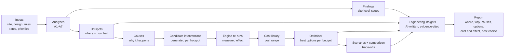

# URBANOVA Phase 1 — smart upgrade specification: from metrics to engineering decisions, with AI

**Status:** **approved** by the project decision maker (data science lead) on 2026-11-04. Supervisor review is still welcome; their comments go into the open decisions in §13. **Implementation has not started**; it begins with stage S1 when the team gives the go-ahead.

**Scope:** this is **still Phase 1**. It does not add a new phase. It upgrades the existing Phase 1 system, whose findings, explanations and recommendations are rule-based today (fixed thresholds and fixed text templates), into one that uses AI and data-driven methods. The Phase 1 Functional Requirements stay the scope. (The file name says PHASE2 only for historical reasons.)

It answers the supervisors' points one by one:
§2 Analysis Mapping, §3 Scientific Validation, §4 Hotspot Detection, §5 Engineering Insights, §6 Recommendations Logic, §7 Scenario Comparison, §8 Reports, §1 System Integration, and §10 Code Changes & Acceptance Criteria.

**What is rule-based today, and what replaces it:**

| Today (Phase 1 as built) | After this upgrade (still Phase 1) |
|---|---|
| A finding fires when one metric crosses a fixed band | Hotspots are located on the drawing with spatial statistics, with area, severity, metrics and causes (§4) |
| Recommendations are fixed templates attached to a finding | Candidate interventions are generated, tested by re-running the engine, priced and ranked (§6) |
| Explanations are fixed sentences | AI writes the engineering insights and report narrative from the evidence, and an automatic check verifies every claim (§5) |
| The report lists metrics and findings | The report answers where, why, causes, options, cost and effect, and best choice for each problem (§8) |
| There is no assistant | A chat assistant answers questions from the results (§9, stage S7) |

## 0. Goal and decisions

**Goal:** turn URBANOVA from "a report full of numbers" into a system that tells an engineer or developer:

* where the problems are on the drawing;
* why they are problems;
* what causes them;
* what can be done, and what each option costs and achieves;
* which option suits the project, and why.

**Decisions taken on 2026-11-04 (decision maker: data science lead):**

| # | Decision |
|---|---|
| S-1 | **AI is a configurable server-side service, free to run in this project.** The engine calls whatever OpenAI-compatible endpoint the deployment configures, so the AI runs wherever the application runs, never only on a developer's laptop. Provider chain (§9): Groq free tier first, OpenRouter free models as backup, a local Ollama model for development and offline tests. Production may switch to a self-hosted model or a paid API by configuration only. This **replaces decision C5** ("deterministic templates only, no generative AI in Phase 1"): AI is now part of Phase 1. |
| S-2 | **"Smart" means four things, in this order of value:** (1) data-driven hotspot detection; (2) a design optimiser that tests real interventions with the engine; (3) AI-written engineering insights grounded in the evidence; (4) a conversational assistant. |
| S-3 | **The AI explains; it never computes or decides numbers.** Every number comes from the engine or the cost library. Every AI sentence that states a fact must cite the evidence it came from, and an automatic check rejects text that doesn't. Rankings and the "best option" are computed by documented rules; the AI explains them. |
| S-4 | **Costs come from a reference cost library with cited sources, which the user can override** with real quotations. Costs are always shown as a range and labelled *indicative*. |
| S-5 | **Spec first.** Nothing is built until this document is approved; then the work goes in the stages of §11. |
| S-6 | **The system must still work with no AI available.** Without a model, the same structured insights appear as plain sentences built from the same evidence, labelled as such. |
| S-7 | **New free data sources** strengthen the analyses (§2.1): address search, terrain, building footprints where OpenStreetMap is empty, land cover, and population. Each is approved and recorded in the provider registry before the code calls it, as with every existing source. |

**Development hardware (2026-11-04):**

* The development PC has an NVIDIA RTX 3050 laptop GPU (6 GB), an Intel i5-13500H and 16 GB of RAM. That is enough to run a quantised 7–8-billion-parameter model locally *for development and offline testing*.
* It is not the deployment target.
* Generation speed has not been measured; it is measured in stage S4.
* Ollama is not installed yet.

## 1. System integration: one chain, each stage feeding the next

Today each analysis runs on its own and findings are attached afterwards. The upgrade makes it one chain. Every record carries the ids of the records it was built from, so any sentence in the report can be traced back to a measurement.



**The id chain:**

* `metric.id` → `hotspot.supporting_metric_ids` → `cause.evidence_ids`
* `intervention.hotspot_id` → `recommendation.intervention_ids` + `evaluation_run_id`
* `scenario.based_on_recommendation_ids`
* `insight.sentence[].evidence_ids`
* `report.section.source_ids`

**Acceptance (integration):**

* For every recommendation in a report, a test can walk the chain back to at least one metric with `state = available`.
* No report sentence is allowed without an id. AI sentences count too.

## 2. Analysis mapping

What each analysis measures, its inputs, method and outputs, and where it stands. "R-x" refers to the reference list in §12.

| Id | Analysis | What it measures | Required inputs (optional) | Method (summary) | Main outputs | Status today |
|---|---|---|---|---|---|---|
| A1 | Climate baseline | How hot the region is, and how often: hot-season maximum temperature, extremes, hot nights | Coordinates (period) | ERA5 reanalysis daily series via Open-Meteo, with NASA POWER as fallback; monthly climatology; ETCCDI indices SU, TR [R-1, R-2]; percentiles | `climate_*` metrics, hottest months | Exists; checked against 2 stations (VALIDATION §1) |
| A2 | Surrounding context | What is mapped around the site: buildings, roads, green | Coordinates (boundary) | OpenStreetMap ways within a buffer; shares of study area | `context_*` metrics, context layer | Exists; OSM completeness unknown |
| A3 | Urban form | How the design uses the site: coverage, green, open and hard surface, spacing, setback, floor-area ratio | Boundary, design (heights, floors) | Exact polygon areas in local UTM; unions so overlaps count once | `building_coverage_ratio_pct`, `green_space_pct`, `hard_surface_pct`, ... | Exists; checked on real geometry (VALIDATION §3) |
| A4 | Vegetation | Where vegetation exists now | Coordinates (boundary, design) | Sentinel-2 L2A NDVI [R-9], SCL cloud mask, median composite; NDVI ≥ 0.2 as the vegetation indicator [R-10] | `ndvi_*` metrics, NDVI layer | Exists; plausibility checked (VALIDATION §2) |
| A5 | Land surface temperature (LST) | Which surfaces are hottest in the hot season, observed | Coordinates (boundary) | Landsat C2 L2 surface temperature [R-8], QA mask, hot-season median, site vs ring | `lst_*` metrics, LST and class layers | Exists; plausibility checked; small sites mix pixels |
| A6 | Solar and shade | Where the sun hits the ground at given hours on a hot-season day | Design with heights (trees with canopy) | NOAA solar position; exact shadow polygons from buildings, trees and shade structures | `solar_*` metrics, shadow layer | Exists; geometry tested against reference values |
| A7 | Planning compliance | Whether the design meets *verified* planning rules | Design, verified rules | Geometric checks (coverage, height, floors, setback, green, open space, FAR) | Pass/fail per rule | Exists |
| **A8** | **Hotspot detection** (new, §4) | Where the problems are on the drawing, how big and how severe | Outputs of A3–A7 | Spatial analysis on a 2 m design grid and the LST grid; Getis–Ord Gi* with false-discovery-rate control [R-3, R-4, R-5] | Hotspot polygons with area, severity, metrics, causes | **New** |
| **A9** | **Intervention evaluation** (new, §6) | What each candidate intervention changes, measured | Design, hotspot, catalogue | Apply the intervention to a copy of the design, re-run A3, A6 and A7, take the difference | Effect per intervention | **New** |
| **A10** | **Cost estimation** (extended, §6.4) | What an intervention costs | Quantities, cost library or quotes | Quantity × unit-cost range (low / typical / high) | Cost range with sources | Exists for quoted rates only; library is new |
| A11 | Scenario comparison (extended, §7) | Which design performs better, at what cost | ≥ 2 analysed designs | Same-data comparison; trade-off (Pareto) analysis; robustness to cost ranges | Comparison, trade-off chart, choice + reasons | Exists; trade-offs are new |

**Acceptance (mapping):** this table is kept as data in `urbanova/config/analyses.json`, and a test checks that every analysis listed there has the following:

* at least one test;
* every metric it emits listed in its outputs;
* a reference for every method it uses.

### 2.1 New free data sources

Chosen after reviewing the [public-apis](https://github.com/public-apis/public-apis) directory and the catalogues of the providers we already use (2026-11-04). Most directory entries are irrelevant to URBANOVA (IP lookup, finance, live weather forecasts). The ones below fill real gaps.

**Use:**

| Source | Gap it fills | Feeds | Access | Status |
|---|---|---|---|---|
| **Microsoft building footprints** (Planetary Computer `ms-buildings`) | OpenStreetMap often has no buildings in new Egyptian districts. The sample site's report said "no mapped buildings" for this reason | A2 context; H2 causes; shade from existing neighbouring buildings (A6) | Same Planetary Computer route already in use; no account | Licence to confirm and record |
| **ESA WorldCover 10 m land cover** (Planetary Computer `esa-worldcover`) | What surrounds and covers the site: built-up, trees, grass, bare ground, water | A2 context; H2 and H3 causes ("surrounded by bare ground", "no tree cover within 500 m") | Same route; no account | Licence to confirm and record |
| **Terrain / elevation**: Open-Meteo elevation API (already a provider) or Open Topo Data | Slope and elevation of the site. Terrain is listed in the FR but not built | New A12 terrain: elevation, slope, low points | No key; usage limits apply | To approve |
| **Nominatim** (OpenStreetMap geocoding) | Create a project from an address instead of coordinates | Project creation (FR-01) | No key; max 1 request/second; attribution required (usage policy) | To approve |
| **WorldPop population** (already registered, not built) | How many people live near a hotspot, so priority reflects people affected | §5 priority; A13 population exposure | Open data (licence to confirm) | Registered as `not_applicable_not_implemented`; to build and approve |

**Maybe, if time allows:**

* **OpenAQ (air quality):** would enable the skipped air-quality context, but monitoring stations in Egypt may be sparse. Coverage to check first.
* **PVGIS (EU JRC solar radiation):** roof solar potential. Useful, but not about heat.
* **Google Earth Engine:** powerful and free for research after registration, but complex; we already have a satellite route.

**Not used:** live-weather and forecast APIs (planning needs long-term climate, which ERA5 provides); country-level statistics (World Bank and similar); small or unknown aggregators.

**Rules:**

* Every new source gets a `providers.json` entry before use: licence, attribution, usage limits, approval, caching rule.
* Failures are reported per module, as for every source.
* None of these sources is required for the core analysis to run.

**Additions to the mapping table:**

| Id | Analysis | What it measures | Inputs | Method | Outputs |
|---|---|---|---|---|---|
| A2+ | Context (extended) | Existing buildings and land cover around the site | Coordinates | OSM + Microsoft footprints (deduplicated by overlap) + WorldCover class shares | `context_*` metrics, which source each building came from |
| A12 | Terrain | Elevation, slope, local low points | Coordinates, boundary | Elevation grid; slope from neighbouring cells | `terrain_*` metrics, slope layer |
| A13 | Population exposure | People living within a set distance of each hotspot | Hotspots, WorldPop grid | Sum of population cells within the distance | `population_near_hotspot` per hotspot |

## 3. Scientific validation

### 3.1 Policy: no number without a source

Every threshold, band, coefficient and default in `urbanova/config/` gets a `basis` record:

| Field | Meaning |
|---|---|
| `basis_type` | `standard` (an international index, e.g. ETCCDI); `regulatory` (a verified planning document of the project); `literature` (peer-reviewed study, with DOI); `statistical` (a significance test, with no fixed physical threshold); `project_choice` (set by the team, with a stated reason); `provisional` (no adequate source yet) |
| `references` | Ids from §12, with page or table where possible |
| `applicability` | Where it holds: e.g. "hot arid climates", "neighbourhood scale, not site scale" |
| `approved_by`, `approved_on` | Supervisor approval; empty means not approved |

**Rules:**

* A `provisional` or unapproved value keeps the existing safeguards: it is labelled PROVISIONAL and its severity is capped at moderate.
* Every report lists all values used, with their basis.
* A test fails if any threshold lacks a `basis` record.

### 3.2 Current values and the proposed basis

| Value used today | Proposed basis | Status after the upgrade |
|---|---|---|
| SU: Tmax > 25 °C; TR: Tmin > 20 °C | ETCCDI definitions [R-1] | `standard`; ERA5's Tmin bias stays stated (VALIDATION §1) |
| TX35 / TX40 very-hot-day counts | No international standard. **Add** ETCCDI TX90p (share of days above the local 90th percentile) [R-1] as the standard index. Keep TX35 as `provisional` context only | TX90p `standard`; TX35 `provisional` |
| LST site − surroundings bands 2 K / 4 K | **Replace** fixed kelvin bands with a statistical test: the site difference in units of the ring's own variability, plus hot-spot significance (§4.3). The surface urban heat island concept follows [R-6] | `statistical` |
| LST hottest decile | **Replace** with Getis–Ord Gi* hot spots, controlled by false discovery rate (q < 0.05) [R-3, R-4, R-5] | `statistical` |
| NDVI ≥ 0.2 = vegetation indicator | Widely used soil/vegetation boundary in NDVI-threshold methods [R-10] | `literature` (to verify [R-10]) |
| Tree-canopy target | 30 % canopy (the "30" of the 3-30-300 rule) [R-7]. It's a neighbourhood guideline, so it is shown as a reference point, not a pass/fail rule | `literature`, applicability stated |
| Green / coverage / setback limits | From the project's **verified** planning documents only; Egyptian law and authority conditions apply per project [R-17]. No default limits are invented | `regulatory` |
| Open-space sun-exposure bands (SHADE-01) | No adequate source found yet; it stays provisional until the literature task in §11 S1 finds one or supervisors set a project choice | `provisional` |
| Cooling effect of parks and greening | Literature range, e.g. parks about 0.94 °C cooler by day on average [R-11], urban forests about 1.6 °C [R-12]. Used **only** as context for expected direction, never as a site prediction | `literature`, labelled "not modelled for this site" |
| Cool pavements | Literature on reflective and permeable pavements [R-13], and on trees and cool pavements effects on mean radiant temperature [R-14] | `literature`, context only |

### 3.3 Validation tests (evidence the methods work)

* **Already done** (VALIDATION.md): ERA5 against 2 NOAA stations; satellite plausibility on known land covers; area calculations on real geometry.
* **Planned in this upgrade:**
  * hotspot detection on synthetic grids with planted clusters: it must find them (recall) and must not find clusters in random noise (false-discovery check);
  * hotspot detection on the real LST composite of the plausibility sites: water and park areas must not be flagged as hot spots;
  * every intervention effect checked against a hand-calculated case;
  * a sensitivity test showing how the recommended option changes when costs move between low and high.

## 4. Hotspot detection

A hotspot is a **place on the drawing**, given as a polygon, with a measured problem, a size, a severity, supporting metrics and likely causes.

### 4.1 Hotspot types

| Type | Problem it locates | Data | Detection method |
|---|---|---|---|
| H1 Sun-exposed hard surface | Paved areas (parking, roads, plazas) in full sun at the analysed hot-season hours | Design (A3), shadows (A6) | 2 m grid over the site. A cell counts if its surface is hard and unshaded; its exposure = share of analysed hours (09:00, 12:00, 15:00, configurable) in sun. Cells with exposure ≥ ⅔ are merged into connected polygons |
| H2 Observed surface-heat cluster | Statistically significant hot clusters in the observed LST | LST composite (A5) | Getis–Ord Gi* on the 30 m LST grid over the study area [R-3, R-4]; Benjamini–Hochberg false discovery rate, q < 0.05 [R-5]; significant hot cells intersecting the site become polygons. The 100 m native resolution is always stated |
| H3 Vegetation and shade deficit | Open areas far from any tree canopy, planting or shade | Design (A3, A6) | Distance from each open-space cell to the nearest canopy or shade structure; cells beyond D metres (default 30 m, `project_choice`, to be approved) become polygons |
| H4 Planning violation location | The exact part of the design that breaks a verified rule | Design, verified rules (A7) | Geometry: e.g. building parts inside the setback band; for a site-wide ratio (green %), the rule failure is attached to the whole site with the shortfall in m² |

### 4.2 Size and severity

* **Size:** area in m², and share of the site. Size class: small < 1 %, medium 1–5 %, large ≥ 5 % of the site (`project_choice`, to be approved).
* **Severity:** a matrix of *intensity* × *size*, where intensity depends on the type:
  * H1: sun exposure (⅔ moderate, 3/3 high);
  * H2: Gi* z-score and LST difference from the ring;
  * H3: distance beyond D;
  * H4: shortfall relative to the limit.

  Severity = high when intensity is high and size is at least medium; moderate when one of the two is high; otherwise low.
* **Labelling:** any severity that depends on a `provisional` or unapproved value carries that label and is capped at moderate (as today).

### 4.3 Supporting metrics and likely causes

Each hotspot carries:

* `supporting_metrics`: the measurements inside its polygon. For example: sun-exposure share; hard-surface share; composition by feature type (e.g. 78 % parking, 22 % road); distance to the nearest canopy; mean NDVI; LST difference from the ring; Gi* z.
* `likely_causes`: produced by **deterministic attribution rules**, each with its evidence id, for example:

| Cause | Rule (all thresholds in config with a basis) |
|---|---|
| "Large paved area" | Hard surface ≥ 70 % of the polygon |
| "No shade at mid-afternoon" | Sunlit at 15:00 over ≥ 80 % of the polygon |
| "No trees nearby" | Nearest canopy > D m |
| "No vegetation observed" | Mean NDVI < 0.2 [R-10] |
| "Exposed west edge" | Polygon adjacent to a building's west façade with no shade |
| "Design exceeds rule X" | Compliance check failed (H4) |

* The AI may **phrase** causes and explain them. It may not add causes that are not on this list.

**Data model:**

```json
{"id": "hs_…", "type": "H1", "geometry": {…}, "area_m2": 1820.4, "site_share_pct": 4.6, "size_class": "medium",
 "severity": "high", "severity_basis": "matrix §4.2; exposure 3/3 (project_choice, approved …)",
 "supporting_metrics": [{"name": "sun_exposed_share", "value": 1.0, "metric_id": "met_…"}, …],
 "likely_causes": [{"code": "LARGE_PAVED_AREA", "evidence": {"hard_share": 0.94}, "evidence_ids": ["met_…"]}],
 "confidence": "high", "confidence_reason": "design geometry and computed shadows; no satellite dependency"}
```

**Acceptance (hotspots):**

* On the synthetic sample site, the surface car park and the paved plaza are detected as H1 with their correct areas (within 1 % of a hand calculation).
* Planted test clusters are recovered, and random noise gives no H2 hotspot at q < 0.05.
* Every hotspot has an area, a severity with its basis, at least one supporting metric and at least one cause with an evidence id.
* Hotspots are drawn on the map and in the report, numbered.

## 5. Engineering insights (AI)

**Purpose:** turn the numbers into understandable statements about the site:

* its overall condition;
* the main problems;
* what needs attention first, and why.

**How it works:**

1. **Evidence pack.** The engine builds a compact JSON with only what the insight may use: site status, hotspots (ranked), findings, key metrics with ids, comparison results, data limitations.
2. **Priority ranking (deterministic).** Priority = severity × size × confidence, with ties broken by the cost-effectiveness of the best available fix. The ranking is computed, so it is reproducible and explainable.
3. **AI writing.** The configured model endpoint (§9) receives the evidence pack and a fixed instruction. It returns **structured JSON**: `site_status`, `top_issues[]` (in the computed order), `attention_first` and `why`. Each sentence lists the `evidence_ids` it relies on.
4. **Validation (automatic, every time).** The answer is rejected if any of these fails:
   * it is not valid JSON;
   * it cites an id that doesn't exist;
   * it contains a number that is not in the cited evidence (rounding tolerance only);
   * it changes the computed order;
   * it uses a forbidden claim type (predicted temperatures, statutory approval, guaranteed savings).
5. **Fallback.** On rejection the model retries once with the validator's message. If it fails again, the deterministic sentence builder is used and the output is labelled "AI text unavailable".
6. **Labelling.** AI-written text is marked as such in the UI and the report. The evidence links are clickable.

**Example (target shape, illustrative wording):** "The site's most urgent problem is the surface car park on the east side (hotspot 1). Its 3,300 m² of paving is in full sun at all three analysed hours, and there is no tree within 45 m [met_…, met_…]. It is the largest exposed hard surface on the site, so it should be addressed first."

**Acceptance (insights):**

* On a fixed set of ≥ 30 evidence packs (synthetic and case study), 100 % of accepted outputs pass validation; the fallback rate is reported.
* No accepted output contains an untraceable number.
* Insights are reproducible with the model temperature at 0.
* With the model switched off, the same structure is produced by the fallback.

## 6. Recommendations logic

### 6.1 Intervention catalogue

`urbanova/config/interventions.json`. Each intervention is a geometry operation the engine can apply and measure:

| Id | Intervention | Applies to | Geometry generated | Measured effect (engine) | Literature context |
|---|---|---|---|---|---|
| I1 | Trees on paving or along edges | H1, H3 | Tree points at spacing S with canopy radius r (from config, with basis) | Δ shaded area, Δ sun-exposed hard surface, Δ canopy share, Δ shade hours | [R-11, R-12, R-14] |
| I2 | Shade structures (pergolas, canopies) | H1, H3 | Shade polygons over selected cells, height h | Δ shaded area and shade hours | [R-14] |
| I3 | Convert paving to planting | H1 | Part of a paved polygon re-typed to green space (keeping access and parking needs as constraints) | Δ green %, Δ hard surface %, compliance change | [R-11] |
| I4 | Cool (high-albedo) paving | H1, H2 | Re-surface paved polygons (material attribute) | Area treated; no surface-temperature modelling in Phase 1 | [R-13] |
| I5 | Reduce or reconfigure parking | H1, H4 | Shrink parking polygons to a target capacity | Δ hard surface, Δ green potential | — |
| I6 | Fix planning violation | H4 | Move or trim building parts out of the setback; add green to meet the verified minimum | Compliance turns to pass | Verified rule |

### 6.2 Why an intervention is proposed

A recommendation exists only when **all** of these hold:

1. there is a hotspot or a finding;
2. the intervention's `applies_to` matches the hotspot type and at least one of its causes;
3. the engine-measured effect is positive on the problem's own metric.

The recommendation then states:

* the problem (with its hotspot id);
* the cause it addresses;
* the evidence;
* the measured effect;
* the cost range;
* the confidence;
* the trade-offs, e.g. "removes 40 parking spaces".

### 6.3 Expected effect

* **Measured** (`output_kind: modelled` by geometry):
  * the indicator changes the engine computes on the modified design (shade, exposure, green, hard surface, compliance);
  * reported as before → after, and as a difference.
* **Literature context only:**
  * temperature effects, given as a cited range with "not modelled for this site";
  * never shown as a site prediction.

### 6.4 Cost

**Cost library** (`urbanova/config/cost_library.json`). Each entry has:

* item, unit, low / typical / high;
* currency and price date;
* source, region and `basis_type`.

| Topic | Detail |
|---|---|
| **Gap found** | The 2026-11-04 search found **no credible public unit costs** for Egyptian landscaping, tree planting or shade structures, only real-estate finishing prices on commercial blogs. Arcadis and Turner & Townsend city surveys did not show Cairo figures in their public excerpts. |
| **Who fills the library** | The library therefore starts **empty for Egypt**. The team collects at least 3 written contractor or supplier quotations per item (S3), recorded with date and source. Supervisors may approve published price lists if they know one. |
| **Without a price** | Until then, costs show "price required", as today. Synthetic demo entries use the test currency XTS and are labelled TEST. |
| **User override** | A user's own quotation always overrides the library. |
| **Calculation** | Cost = quantity × unit cost, shown as low / typical / high. |
| **Ageing** | A price older than 2 years is flagged. Inflation adjustment is out of scope, since no approved index has been chosen. |

### 6.5 Confidence level of a recommendation

High, medium or low, computed from three factors and always shown with its reasons:

| Factor | High | Medium | Low |
|---|---|---|---|
| Evidence for the effect | Engine-measured indicator change | Literature range applied by analogy | Assumption only |
| Input data quality | Module completed, design reviewed | Module partial (e.g. few scenes, small-site LST) | Inputs flagged for review |
| Cost basis | Project quotation | Library entry < 2 years old | Old entry, or no price |

Overall confidence = the lowest of the three factors. Each reason is listed, e.g. "Medium: cost from library entry dated 2026-03".

### 6.6 The optimiser: choosing options, not listing templates

For each hotspot:

1. **Generate candidates.** Create a small set of candidates from the applicable interventions at a few intensities, e.g. trees at 3 spacings, or shade over 50 / 100 % of the hotspot.
2. **Evaluate.** Run the fast modules (A3, A6, A7) on each candidate design. These are seconds per run, and no satellite data is needed.
3. **Score.** Compute benefit (the problem metric's improvement) and cost range.
4. **Select.** Keep the **Pareto-efficient** options, i.e. those that no other option beats on both benefit and cost.
5. **Recommend:**
   * the option with the best benefit per cost;
   * the option with the largest benefit;
   * the cheapest effective option.
6. **Package.** Assemble a site-wide package within the user's budget (greedy by benefit per cost, then re-evaluated together), saved as a draft alternative. **It is analysed as a scenario only after the user approves it.**

**Acceptance (recommendations):**

* On the synthetic site, the car-park hotspot gets at least two Pareto options.
* Each recommendation's measured effect equals an independent re-run of the engine on that option.
* Every recommendation shows a cost range or "price required", plus confidence with reasons.
* No draft is analysed without approval.

## 7. Scenario comparison

Builds on the existing like-for-like comparison:

* **Improvements and regressions:** for every metric, plus hotspot counts and areas by severity, and planning compliance.
* **Trade-offs:**
  * a cost-vs-environmental-performance chart (Pareto front) across the designs;
  * a "what you give up" list, e.g. parking spaces, built area, maintenance needs from the catalogue.
* **The choice:** "most suitable design" is computed from the user's stated priorities: weights for heat, green, shade, cost and compliance, plus an optional budget. A design that fails a verified rule cannot be recommended.
* **Robustness:** the choice is re-computed with low and high costs and with ±20 % weights. The report says whether the choice is robust or sensitive, and to what.
* **AI explains the choice** (§5 rules apply). It never makes the choice.

**Acceptance (comparison):**

* The baseline and the optimiser's draft alternative compare with consistent site data.
* The trade-off chart and the robustness statement appear.
* The chosen design and its reasons can be traced to ids.

## 8. Reports

The report is reorganised around the supervisors' six questions. The current technical content (metrics tables, methods, provenance) moves to appendices.

1. **Executive summary** (one page):
   * the site's condition;
   * the 3 most important problems;
   * the recommended design and why;
   * total indicative cost range;
   * confidence.
2. **One section per hotspot**, in priority order:
   * **Where is the problem?** Map extract with the hotspot outlined; area and share of site.
   * **Why is it a problem?** The measured evidence and its basis or reference.
   * **What causes it?** The attributed causes with evidence.
   * **What solutions are available?** A table of the Pareto options.
   * **What does each cost, and what effect does it have?** Cost range, measured effect, literature context, confidence.
   * **Which option suits the project, and why?** The computed choice for this hotspot, explained.
3. **Design comparison and trade-offs:** baseline vs alternatives, trade-off chart, robustness.
4. **Recommended design for the project:** the choice, its conditions (budget, priorities) and the next steps (e.g. obtain quotations, a detailed microclimate study).
5. **Appendices:** data sources and licences, methods, every threshold with its basis (§3.1), limitations, references, reproducibility record.

**Rules:**

* English only (decision C4); Arabic original wording is quoted where relevant.
* AI text is marked as such.
* Synthetic or fictitious data is labelled on every page.

**Acceptance (reports):**

* A test generates the report for the synthetic site and checks:
  * each hotspot section has all six parts;
  * every sentence carries a source id;
  * the executive summary's numbers match the sections.
* A reviewer can answer the six questions for each hotspot from the report alone (checked by a supervisor on one report).

## 9. AI architecture: a server-side, provider-neutral service

The AI is part of the deployed system, not of a developer's machine. The analysis engine (on the server, or inside the backend team's platform) calls a model endpoint over HTTP using the OpenAI-compatible chat API. Which model answers is **configuration**, so the same code runs in every environment:

| Environment | Where the model runs | Cost | Data | Limits |
|---|---|---|---|---|
| Development and offline tests | Developer's PC, Ollama (`http://localhost:11434/v1`) [R-16] | Free | Stays on the PC | Speed of the laptop GPU |
| Deployed demo and backend integration (this project) | **Provider chain** (below): Groq free tier first, then OpenRouter free models, then the deterministic fallback | Free | **Sent to the provider:** only synthetic or approved data, see §13 | Daily/minute request limits; free models can change |
| Production (decided later by the backend team) | Either a self-hosted open model on the backend's GPU server (e.g. vLLM or Ollama, OpenAI-compatible), or a paid API | Hardware or usage cost | Stays in the backend's infrastructure (self-hosted) or under a paid data agreement | Set by the backend |

**Provider chain for the deployed system (all OpenAI-compatible, all free tiers):**

| Order | Provider | Role | Notes |
|---|---|---|---|
| 1 | **Groq** [R-18] | Primary | Free plan, fast, open models (Llama, Qwen, GPT-OSS). Exact free limits are shown only in the account; developer-plan figures are 30 requests/min and 1,000/day for some models |
| 2 | **OpenRouter** free models [R-19] | Backup when Groq is down or over its limit | `:free` models rotate; free accounts get about 50 requests/day (third-party figure, to verify) |
| 3 | Deterministic fallback | Always available | Same structure, plain sentences, labelled "AI text unavailable" |
| dev | Ollama, local [R-16] | Development and offline tests | Not used by the deployed system |

**Considered and not chosen:**

* **Optional extras:** Google Gemini, Mistral AI, Together AI and Hugging Face have free tiers. They can be added to the chain later, but their limits and data-use terms are not verified yet; Gemini's free-tier data use in particular must be checked before any real project data is sent.
* **Not used:** Cohere (trial keys only) and small or unknown aggregators (reliability risk for a graduation project).

**What stays the same in every environment (engine side):**

| Part | Behaviour |
|---|---|
| Provider chain | Tried in order; a provider that fails, times out or is over its limit is skipped for the rest of the day, and the next is used. The model and provider used are recorded on every AI field. |
| Grounding validator (§5 step 4) | Rejects untraceable numbers, wrong ids and forbidden claims. This is what makes free or smaller models safe to use. |
| Fallback | If the endpoint is down, over its rate limit, slow (timeout, default 30 s) or keeps failing validation, the deterministic text is used and labelled "AI text unavailable". **Analysis results never depend on the model.** |
| Caching | AI output is cached by `(evidence-pack hash, model, prompt version)`, so re-opening a report or re-generating it costs no new calls. This matters for free-tier limits. |
| Budget | `URBANOVA_LLM_MAX_CALLS_PER_DAY` stops calls before a free tier's daily limit, then switches to the fallback. |
| Data minimisation | The evidence pack sends metrics, hotspot summaries and ids, never uploaded files, drawings, personal data or API keys. |
| Model choice | In S4 the candidates (e.g. a free hosted Llama/Qwen/GPT-OSS model and a local 7–8B model) are compared on the §5 test set by validation pass rate, speed and free-tier fit. The result is recorded here. |
| Chat assistant (S7) | Same service; tools: `get_hotspot`, `get_metric`, `compare`, `draft_alternative`. Answers come from the results only, and drafts need approval. |

**Settings (environment variables, set per deployment):**

* `URBANOVA_LLM_PROVIDERS`: the ordered chain, e.g. `groq,openrouter`;
* per provider: `URBANOVA_LLM_<NAME>_BASE_URL`, `URBANOVA_LLM_<NAME>_MODEL`, `URBANOVA_LLM_<NAME>_API_KEY` (server-side only, never logged or sent to the browser);
* `URBANOVA_LLM_ENABLED`;
* `URBANOVA_LLM_TIMEOUT_S`;
* `URBANOVA_LLM_MAX_CALLS_PER_DAY`.

**For the backend team:**

* The model endpoint is an external dependency of the engine, exactly like the climate and satellite providers. Their job is to supply the URL and key (or to host a model), plus monitoring.
* The engine's contract marks every AI-written field with `generated_by: "ai" | "fallback"` and the model name.

## 10. Code changes and acceptance criteria

| Part | Code changes | Done when (acceptance criteria) |
|---|---|---|
| Analysis mapping | `urbanova/config/analyses.json`; test linking analyses, metrics, references and tests | §2 acceptance passes; table generated into the docs |
| Scientific basis | `basis` records for every config value; ETCCDI TX90p in `analysis/climate.py`; statistical LST test replaces K bands | Test fails on any value without a basis; report appendix lists all values with basis; TX90p validated against a hand calculation |
| Hotspots | New `analysis/hotspots.py` (H1–H4), `analysis/spatial_stats.py` (Gi*, FDR); `findings.py` links findings to hotspots | §4 acceptance; synthetic cluster recall/false-positive tests; hotspots in engine result contract (minor version 1.1) |
| Interventions and cost | `urbanova/config/interventions.json`, `urbanova/config/cost_library.json`; new `interventions.py` (geometry generators), `optimiser.py`; `cost.py` gains ranges | §6 acceptance; effect = independent re-run; cost shows a range or "price required" |
| AI layer | New `ai/llm.py` (OpenAI-compatible client with the provider chain, timeouts, daily budget, cache), `ai/evidence.py` (evidence pack), `ai/insights.py`, `ai/validate.py` (grounding validator), `ai/fallback.py` | §5 acceptance; validator unit tests with deliberately wrong answers (fabricated number, wrong id, changed order, forbidden claim) all rejected; chain test: provider 1 failing → provider 2 used → both failing → fallback, with the provider recorded each time |
| New data sources | `providers/buildings.py` (Microsoft footprints), `providers/landcover.py` (WorldCover), `providers/elevation.py`, `providers/geocode.py` (Nominatim), `providers/population.py` (WorldPop); new `analysis/terrain.py`; registry entries | §2.1 sources registered with licence and approval; each works offline-mocked in tests; a failing source leaves the other modules unaffected; OSM + Microsoft buildings deduplicated (no building counted twice) |
| Comparison | `comparison.py`: Pareto front, priorities, robustness | §7 acceptance |
| Report | `report.py` restructured (§8); hotspot map extracts | §8 acceptance; PDF and HTML both pass the six-part test |
| UI | Hotspot layer and list; recommendation cards with cost, effect and confidence; approve-draft flow; insight panel with evidence links; settings for the model | Manual walkthrough on the synthetic site, recorded; no console errors |
| Contract | Engine result gains `hotspots`, `recommendations[].options`, `insights`; `contract_version` 1.1, additive only | Schema test passes; 1.0 consumers still validate |

## 11. Stages

Each stage ends with all tests passing and a short demo to you.

| Stage | Content | Exit criteria | Needs from the team |
|---|---|---|---|
| S1 | Analysis mapping, `basis` records, reference verification, TX90p, statistical LST test | §2 and §3 acceptance | Supervisor review of every `project_choice` and `provisional` value |
| S2 | New data sources (§2.1: Microsoft buildings, WorldCover, terrain, Nominatim, WorldPop), then hotspot detection H1–H4 using them | §2.1 and §4 acceptance | Approval of each new source; approval of the size classes, exposure rule and D |
| S3 | Intervention catalogue, cost library, optimiser | §6 acceptance | ≥ 3 written quotations per cost item, or supervisor-approved price lists |
| S4 | AI service: provider chain (Groq → OpenRouter → fallback), validator, caching, call budget; model selection | §5 acceptance on Groq, OpenRouter and a local model; measured speed, pass rate and calls per report | Free accounts and API keys for Groq and OpenRouter (kept server-side); Ollama on the dev PC (about 5 GB of disk) |
| S5 | Comparison trade-offs and robustness | §7 acceptance | Default priority weights |
| S6 | Report restructure and UI | §8 and UI acceptance | Supervisor reads one report and confirms the six questions are answered |
| S7 | Chat assistant | Grounded answers on ≥ 30 questions; correct refusals | — |

## 12. References

"Verified" means the bibliographic details (journal, DOI) were confirmed by a web search on 2026-11-04. The rest must be verified in S1 before use.

| Id | Reference | Used for | Verified |
|---|---|---|---|
| R-1 | Zhang, X. et al. (2011). Indices for monitoring changes in extremes based on daily temperature and precipitation data. *WIREs Climate Change* 2(6), 851–870. doi:10.1002/wcc.147 | ETCCDI indices SU, TR, TX90p | to verify |
| R-2 | Hersbach, H. et al. (2020). The ERA5 global reanalysis. *Q. J. R. Meteorol. Soc.* 146, 1999–2049. doi:10.1002/qj.3803 | Climate baseline data | to verify |
| R-3 | Getis, A., Ord, J. K. (1992). The analysis of spatial association by use of distance statistics. *Geographical Analysis* 24(3). doi:10.1111/j.1538-4632.1992.tb00261.x | Hotspot statistic | **verified** |
| R-4 | Anselin, L. (1995). Local indicators of spatial association — LISA. *Geographical Analysis* 27(2), 93–115. doi:10.1111/j.1538-4632.1995.tb00338.x | Local spatial statistics | **verified** |
| R-5 | Benjamini, Y., Hochberg, Y. (1995). Controlling the false discovery rate. *J. R. Stat. Soc. B* 57(1), 289–300. doi:10.1111/j.2517-6161.1995.tb02031.x | Multiple-testing control for hotspots | to verify |
| R-6 | Voogt, J. A., Oke, T. R. (2003). Thermal remote sensing of urban climates. *Remote Sensing of Environment* 86(3), 370–384. doi:10.1016/S0034-4257(03)00079-8 | Surface urban heat island concept | to verify |
| R-7 | Konijnendijk, C. C. (2023). Evidence-based guidelines for greener, healthier, more resilient neighbourhoods: introducing the 3–30–300 rule. *J. For. Res.* 34, 821–830. doi:10.1007/s11676-022-01523-z | Canopy reference point (30 %) | **verified** |
| R-8 | USGS. Landsat 8–9 Collection 2 Level-2 Science Product Guide | LST scaling and QA | to verify (document version) |
| R-9 | Tucker, C. J. (1979). Red and photographic infrared linear combinations for monitoring vegetation. *Remote Sensing of Environment* 8(2), 127–150. doi:10.1016/0034-4257(79)90013-0 | NDVI | to verify |
| R-10 | Sobrino, J. A., Jiménez-Muñoz, J. C., Paolini, L. (2004). Land surface temperature retrieval from LANDSAT TM 5. *Remote Sensing of Environment* 90(4), 434–440. doi:10.1016/j.rse.2004.02.003 | NDVI 0.2 soil/vegetation boundary | to verify |
| R-11 | Bowler, D. E. et al. (2010). Urban greening to cool towns and cities: a systematic review of the empirical evidence. *Landscape and Urban Planning* 97(3), 147–155. doi:10.1016/j.landurbplan.2010.05.006 | Park cooling context (≈0.94 °C by day) | **verified** |
| R-12 | Knight, T. et al. (2021). How effective is 'greening' of urban areas in reducing human exposure to ground-level ozone concentrations, UV exposure and the 'urban heat island effect'? An updated systematic review. *Environmental Evidence* 10. doi:10.1186/s13750-021-00226-y | Urban forest cooling context (≈1.6 °C) | **verified** |
| R-13 | Santamouris, M. (2013). Using cool pavements as a mitigation strategy to fight urban heat island — a review of the actual developments. *Renewable and Sustainable Energy Reviews* 26, 224–240. doi:10.1016/j.rser.2013.05.047 | Cool pavement context | **verified** |
| R-14 | Taleghani, M., Sailor, D., Ban-Weiss, G. A. (2016). Micrometeorological simulations to predict the impacts of heat mitigation strategies on pedestrian thermal comfort in a Los Angeles neighborhood. *Environmental Research Letters* 11(2), 024003. doi:10.1088/1748-9326/11/2/024003 | Trees vs cool pavements on mean radiant temperature | DOI verified; title to verify |
| R-15 | Ord, J. K., Getis, A. (1995). Local spatial autocorrelation statistics: distributional issues and an application. *Geographical Analysis* 27(4), 286–306. doi:10.1111/j.1538-4632.1995.tb00912.x | Gi* z-score form | to verify |
| R-16 | Ollama documentation: OpenAI compatibility, https://docs.ollama.com/api/openai-compatibility | Local model API | **verified** (2026-11-04) |
| R-17 | Egypt Unified Building Law No. 119 of 2008 and its executive regulations; New Urban Communities Authority conditions for the specific project | Regulatory limits (per project, verified by the user) | Law exists; specific ratios **not found**, must come from the project's documents |
| R-18 | Groq rate limits, https://console.groq.com/docs/rate-limits | Primary free hosted model | Page verified; free-plan limits are shown only in the account |
| R-19 | OpenRouter, free models and limits, https://openrouter.ai/ | Backup free hosted model | Listed in public-apis; limits from a third-party comparison, **to verify** |
| R-20 | Microsoft Global ML Building Footprints (Planetary Computer `ms-buildings`) | Buildings where OSM is empty | **to verify** (licence, Egypt coverage) |
| R-21 | ESA WorldCover 10 m land cover (Planetary Computer `esa-worldcover`) | Land-cover context and causes | **to verify** (licence, version, citation) |
| R-22 | Nominatim usage policy, https://operations.osmfoundation.org/policies/nominatim/ | Address search | Listed in public-apis; policy **to verify** |
| R-23 | Open-Meteo elevation API or Open Topo Data (elevation datasets) | Terrain | **to verify** (dataset, resolution, licence) |
| R-24 | WorldPop population grids | Population near hotspots | **to verify** (licence, year, resolution) |
| R-25 | public-apis directory, https://github.com/public-apis/public-apis | Source review of candidate APIs, 2026-11-04 | Reviewed |

## 13. Open decisions for the team and supervisors

1. Approve or change the `project_choice` values: hotspot size classes, the exposure rule (⅔ of hours), deficit distance D = 30 m, analysed hours, intervention spacings and canopy radii.
2. A basis for open-space sun-exposure bands (SHADE-01), or keep them provisional.
3. Cost data: who collects the quotations, and whether a published Egyptian price list is acceptable.
4. Default priority weights for choosing a design (heat, green, shade, cost, compliance).
5. Approve the AI provider chain (Groq, then OpenRouter), and decide whether real project data may be sent to it (privacy), or only synthetic and approved data until the backend hosts its own model.
6. Approve each new data source in §2.1 (Microsoft buildings, WorldCover, terrain, Nominatim, WorldPop) once its licence is checked, and decide whether OpenAQ and PVGIS are in scope.
